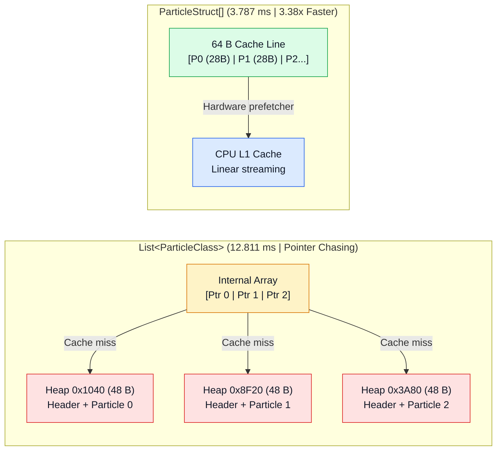

# Data Locality (`ParticleStruct[]` vs `List<ParticleClass>`)

## Table of Contents

- [Intuition: The Warehouse Scavenger Hunt](#intuition-the-warehouse-scavenger-hunt)
- [CPU Cache Hierarchy and Cache-Line Mechanics](#cpu-cache-hierarchy-and-cache-line-mechanics)
- [Naive vs. Contiguous Walkthrough](#naive-vs-contiguous-walkthrough)
- [Trade-offs and Pitfalls (When NOT to Use)](#trade-offs-and-pitfalls-when-not-to-use)
- [Profiling and Diagnostics](#profiling-and-diagnostics)
- [Summary and Benchmark Results](#summary-and-benchmark-results)

---

## Intuition: The Warehouse Scavenger Hunt

Imagine picking 50,000 boxes in a giant warehouse. In the first warehouse (`List<ParticleClass>`), you are handed a clipboard with 50,000 sticky notes, each pointing to a random aisle and shelf somewhere in the building. You walk to aisle 42, grab one box, read the next note, walk to aisle 3, and repeat. You spend almost all your time walking, not packing.

In the second warehouse (`ParticleStruct[]`), all 50,000 boxes are lined up side-by-side on a single conveyor belt. Whenever you reach for one box, the belt automatically slides the next several boxes right into your hands before you even ask. That conveyor belt is your CPU's **hardware prefetcher**, and each tray of boxes it delivers at once is a **64-byte cache line**.

---

## CPU Cache Hierarchy and Cache-Line Mechanics

Modern CPUs are orders of magnitude faster than main memory (DRAM):

- **L1 cache**: ~1 ns (~4 cycles), ~32–64 KB per core
- **L2 cache**: ~4 ns (~12 cycles), ~256 KB–1 MB per core
- **L3 cache**: ~15–20 ns (~40 cycles), shared across cores
- **Main RAM (DRAM)**: ~60–100 ns (~200+ cycles)

When the CPU reads a single `float`, it never fetches just 4 bytes from RAM—it fetches an entire **64-byte cache line**. In [ParticleClass.cs](../Data/ParticleClass.cs), each heap object has a 16-byte .NET header + MethodTable pointer (which identifies the object's runtime type) plus 28 bytes of fields (`44 B`, padded to `48 B` on 64-bit), plus an `8 B` pointer in `List<ParticleClass>`. Worse, as `CreateClassList(..., scatterHeap: true)` simulates, objects allocated over time sit at non-contiguous heap addresses, causing **pointer chasing** and constant L1/L2/L3 cache misses.

```text
List<ParticleClass> (Pointer Chasing):
  List buffer: [Ptr0][Ptr1][Ptr2]... ---> scattered 48 B heap objects (cache miss per dereference)

ParticleStruct[] (Contiguous 28 B structs):
  64-byte Cache Line: [P0 (28B)][P1 (28B)][P2.X, P2.Y (8B)]  --> ~2.28 particles per line, linear stride!
```



---

## Naive vs. Contiguous Walkthrough

### 1. Scattered Heap References (`ParticleUpdateSimulator.UpdateClassList`)

In [ParticleUpdateSimulator.cs](../Data/ParticleUpdateSimulator.cs), `CreateClassList` shuffles references to model real-world heap fragmentation after allocations and GC compactions. Then `UpdateClassList` loops over `50,000` particles for `60` frames:

```csharp
for (int i = 0; i < particles.Count; i++)
{
    particles[i].Step(dt);
}
```

Each `particles[i]` lookup reads an 8-byte pointer, stalls waiting for the remote heap address if it misses L1/L2, and defeats the CPU's linear stride prefetcher.

### 2. Contiguous Inline Array (`ParticleUpdateSimulator.UpdateStructArray`)

[ParticleStruct.cs](../Data/ParticleStruct.cs) holds the exact same 7 `float` fields (`28 B`), stored inline inside `ParticleStruct[]`:

```csharp
for (int i = 0; i < particles.Length; i++)
{
    particles[i].Step(dt);
}
```

Indexing `particles[i].Step(dt)` mutates the array slot **in place** without copying the struct. And when summing results at the end, `UpdateStructArray` uses `ref readonly ParticleStruct p = ref particles[i];` to read fields directly from the array slot with zero struct copy. The CPU prefetcher detects the constant `28 B` stride and streams cache lines ahead of the loop.

---

## Trade-offs and Pitfalls (When NOT to Use)

1. **Copying structs into locals**: Writing `var p = particles[i]; p.Step(dt);` mutates a stack **copy**, leaving `particles[i]` unchanged. Always call mutating methods directly on `particles[i]` or via `ref ParticleStruct p = ref particles[i];`.
2. **Large structs**: Once a `struct` grows past ~32–64 bytes, passing it by value incurs noticeable copy overhead unless you use `ref` / `in` / `ref readonly` parameters.
3. **Resizing `List<T>` of structs**: Growing a `List<ParticleStruct>` copies the entire contiguous buffer on reallocation; pre-size capacity up front (`new ParticleStruct[count]`).
4. **When NOT to use**: Use `class` when you need reference identity (multiple systems holding pointers to the same entity), inheritance/virtual dispatch, or when objects are few and long-lived.

---

## Profiling and Diagnostics

Measure cache behavior, JIT codegen, and heap footprint using BenchmarkDotNet and dotnet tools:

```bash
# Run DataLocality benchmark with memory and JIT disassembly diagnostics
dotnet run --project CSharpLessons -c Release -- --filter "*DataLocality*" --job short --memory --disasm

# Monitor GC heap and allocation rate during simulation runs
dotnet-counters monitor --process-id <PID> --counters System.Runtime[alloc-rate,gc-heap-size]
```

Check `GC.GetAllocatedBytesForCurrentThread()` around `UpdateStructArray` to verify `0 B` per-frame allocations, and use **PerfView** or Linux `perf stat -e cache-misses,L1-dcache-load-misses` to observe hardware cache-miss drops directly.

---

## Summary and Benchmark Results

Measured on .NET 9.0.22 (AMD Ryzen 7 5800X, `50,000` particles of `28 B` updated over `60` frames) in [Benchmark.md](../Benchmark.md):

| Method | Mean | StdDev | Ratio | Speedup |
|---|---:|---:|---:|---:|
| `UpdateClassList` (`List<ParticleClass>`, scattered heap) | `12.811 ms` | `0.157 ms` | `1.00` | `1.00x` |
| `UpdateStructArray` (`ParticleStruct[]`, contiguous) | `3.787 ms` | `0.093 ms` | `0.30` | `3.38x` faster |

**Key takeaway**: Eliminating per-object heap headers and pointer chasing cuts 60-frame update time by **`70.4%` (`3.38x` faster)** purely through CPU cache locality and hardware prefetching.
