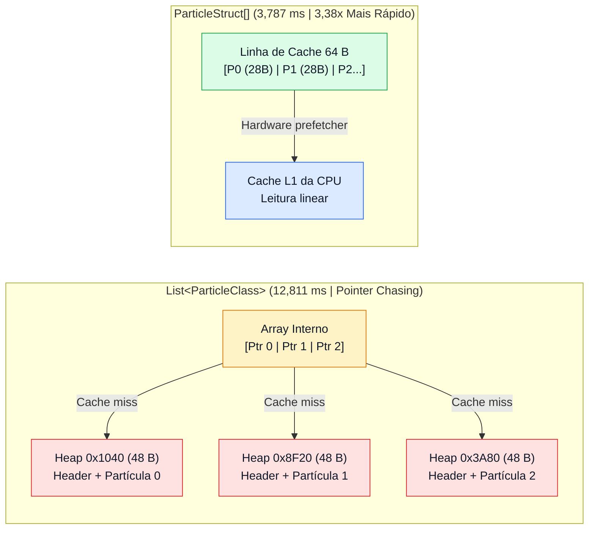

# Localidade de Dados (`ParticleStruct[]` vs `List<ParticleClass>`)

## Índice

- [Intuição: A Caça ao Tesouro no Galpão](#intuição-a-caça-ao-tesouro-no-galpão)
- [Hierarquia de Cache da CPU e Linhas de Cache](#hierarquia-de-cache-da-cpu-e-linhas-de-cache)
- [Passo a Passo: Lista Espalhada vs. Array Contíguo](#passo-a-passo-lista-espalhada-vs-array-contíguo)
- [Trade-offs e Armadilhas (Quando NÃO Usar)](#trade-offs-e-armadilhas-quando-não-usar)
- [Profiling e Diagnóstico](#profiling-e-diagnóstico)
- [Resumo e Resultados do Benchmark](#resumo-e-resultados-do-benchmark)

---

## Intuição: A Caça ao Tesouro no Galpão

Imagine separar 50.000 caixas em um galpão gigante. No primeiro galpão (`List<ParticleClass>`), você recebe uma prancheta com 50.000 bilhetes, cada um apontando para um corredor e prateleira aleatórios. Você anda até o corredor 42, pega uma caixa, lê o próximo bilhete, vai até o corredor 3 e repete. Quase todo o seu tempo é gasto caminhando, não processando caixas.

No segundo galpão (`ParticleStruct[]`), todas as 50.000 caixas estão enfileiradas lado a lado em uma única esteira rolante. Ao pegar uma caixa, a esteira já desliza as próximas diretamente para suas mãos antes mesmo de você pedir. Essa esteira é o **hardware prefetcher** da CPU, e cada bandeja entregue de uma vez é uma **linha de cache de 64 bytes**.

---

## Hierarquia de Cache da CPU e Linhas de Cache

CPUs modernas são ordens de grandeza mais rápidas que a memória principal (DRAM):

- **Cache L1**: ~1 ns (~4 ciclos), ~32–64 KB por núcleo
- **Cache L2**: ~4 ns (~12 ciclos), ~256 KB–1 MB por núcleo
- **Cache L3**: ~15–20 ns (~40 ciclos), compartilhado entre núcleos
- **RAM Principal (DRAM)**: ~60–100 ns (~200+ ciclos)

Quando a CPU lê um único `float`, ela nunca busca apenas 4 bytes na RAM — ela traz uma **linha de cache inteira de 64 bytes**. Em [ParticleClass.cs](../Data/ParticleClass.cs), cada objeto no heap carrega 16 bytes de cabeçalho .NET + ponteiro de MethodTable (que identifica o tipo do objeto em runtime) mais 28 bytes de campos (`44 B`, alinhados para `48 B` em 64 bits), além de `8 B` do ponteiro na `List<ParticleClass>`. Como `CreateClassList(..., scatterHeap: true)` simula, objetos alocados ao longo do tempo ficam espalhados pelo heap, causando **pointer chasing** e cache misses constantes em L1/L2/L3.

```text
List<ParticleClass> (Pointer Chasing):
  Array da Lista: [Ptr0][Ptr1][Ptr2]... ---> objetos de 48 B espalhados (cache miss por acesso)

ParticleStruct[] (Structs contíguas de 28 B):
  Linha de Cache 64 B: [P0 (28B)][P1 (28B)][P2.X, P2.Y (8B)]  --> ~2,28 partículas por linha!
```



---

## Passo a Passo: Lista Espalhada vs. Array Contíguo

### 1. Referências Espalhadas no Heap (`ParticleUpdateSimulator.UpdateClassList`)

Em [ParticleUpdateSimulator.cs](../Data/ParticleUpdateSimulator.cs), `CreateClassList` embaralha as referências para reproduzir a fragmentação real do heap após alocações e compactações do GC. Em seguida, `UpdateClassList` percorre `50.000` partículas por `60` frames:

```csharp
for (int i = 0; i < particles.Count; i++)
{
    particles[i].Step(dt);
}
```

Cada acesso `particles[i]` lê um ponteiro de 8 bytes, trava esperando o endereço remoto no heap quando ocorre miss em L1/L2 e impede o prefetcher linear da CPU.

### 2. Array Contíguo Inline (`ParticleUpdateSimulator.UpdateStructArray`)

[ParticleStruct.cs](../Data/ParticleStruct.cs) guarda os mesmos 7 campos `float` (`28 B`), armazenados diretamente dentro de `ParticleStruct[]`:

```csharp
for (int i = 0; i < particles.Length; i++)
{
    particles[i].Step(dt);
}
```

Indexar `particles[i].Step(dt)` altera o slot do array **no lugar**, sem copiar a struct. Na soma final, `UpdateStructArray` usa `ref readonly ParticleStruct p = ref particles[i];` para ler os campos diretamente do array com zero cópia. O prefetcher detecta o passo fixo de `28 B` e antecipa as próximas linhas de cache antes do loop chegar nelas.

---

## Trade-offs e Armadilhas (Quando NÃO Usar)

1. **Copiar structs para variáveis locais**: Escrever `var p = particles[i]; p.Step(dt);` altera apenas uma **cópia** na stack, deixando `particles[i]` intacto. Sempre invoque métodos mutáveis em `particles[i]` ou use `ref ParticleStruct p = ref particles[i];`.
2. **Structs grandes**: Quando uma `struct` passa de ~32–64 bytes, passá-la por valor gera custo de cópia, exigindo parâmetros `ref`, `in` ou `ref readonly`.
3. **Redimensionamento de `List<T>` de structs**: Crescer uma `List<ParticleStruct>` copia todo o buffer contíguo na realocação; pré-aloque a capacidade exata (`new ParticleStruct[count]`).
4. **Quando NÃO usar**: Use `class` quando precisar de identidade por referência (vários sistemas apontando para a mesma entidade), herança/polimorfismo ou para poucos objetos de vida longa.

---

## Profiling e Diagnóstico

Meça comportamento de cache, código JIT e uso de heap com BenchmarkDotNet e ferramentas do SDK:

```bash
# Executar benchmark de DataLocality com diagnóstico de memória e disassembly JIT
dotnet run --project CSharpLessons -c Release -- --filter "*DataLocality*" --job short --memory --disasm

# Monitorar tamanho do heap e taxa de alocação durante a simulação
dotnet-counters monitor --process-id <PID> --counters System.Runtime[alloc-rate,gc-heap-size]
```

Use `GC.GetAllocatedBytesForCurrentThread()` ao redor de `UpdateStructArray` para confirmar `0 B` alocados por frame, e utilize **PerfView** ou `perf stat -e cache-misses,L1-dcache-load-misses` no Linux para observar a queda de cache misses diretamente no hardware.

---

## Resumo e Resultados do Benchmark

Medido no .NET 9.0.22 (AMD Ryzen 7 5800X, `50.000` partículas de `28 B` atualizadas por `60` frames) em [Benchmark.md](../Benchmark.md):

| Método | Média | Desvio Padrão | Razão | Ganho |
|---|---:|---:|---:|---:|
| `UpdateClassList` (`List<ParticleClass>`, heap espalhado) | `12,811 ms` | `0,157 ms` | `1,00` | `1,00x` |
| `UpdateStructArray` (`ParticleStruct[]`, contíguo) | `3,787 ms` | `0,093 ms` | `0,30` | `3,38x` mais rápido |

**Conclusão prática**: Eliminar cabeçalhos individuais no heap e pointer chasing reduz o tempo de atualização de 60 frames em **`70,4%` (`3,38x` mais rápido)** exclusivamente graças à localidade de dados e ao hardware prefetcher.
