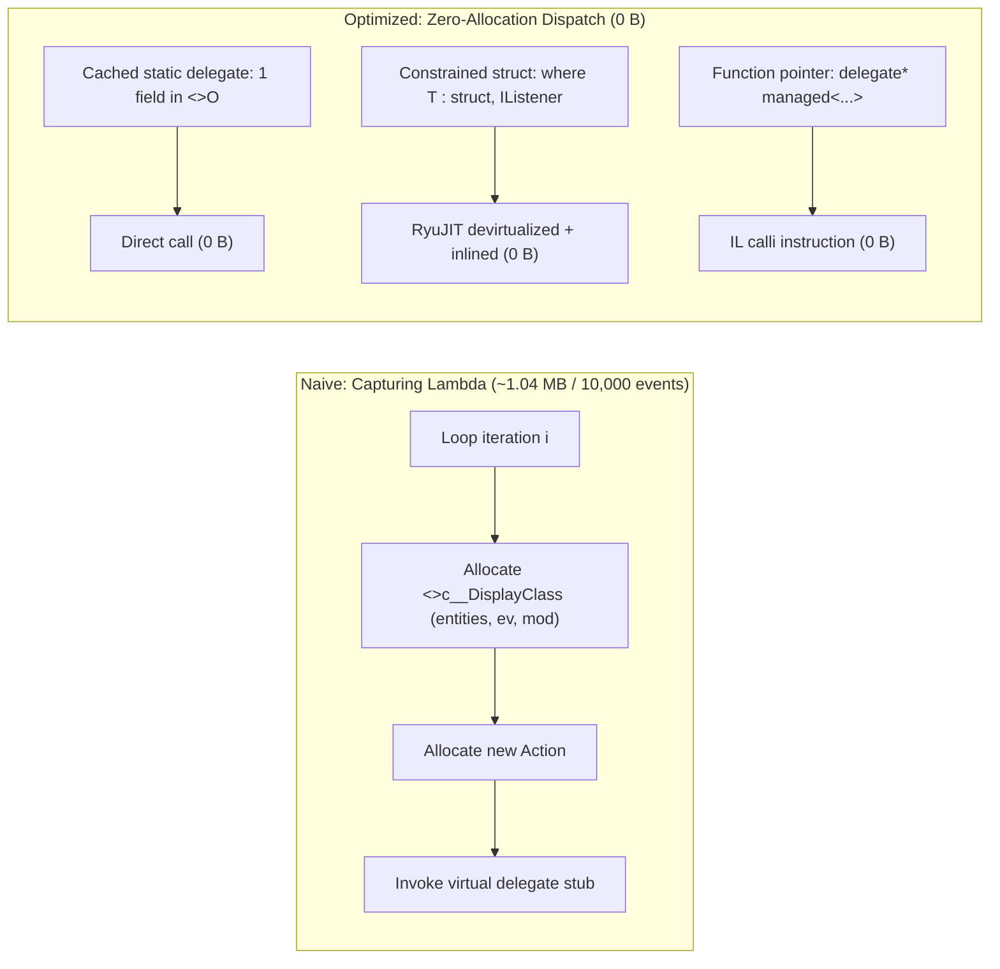

# Delegate Caching & Zero-Allocation Event Dispatch in C#

## Table of Contents

- [Introduction](#introduction)
- [What Actually Happens Under the Hood?](#what-actually-happens-under-the-hood)
- [Step-by-Step Code Walkthrough](#step-by-step-code-walkthrough)
  - [1. Capturing Lambdas (Naive)](#1-capturing-lambdas-naive)
  - [2. Cached Static Delegates with Explicit State](#2-cached-static-delegates-with-explicit-state)
  - [3. Constrained Generic Interface Dispatch](#3-constrained-generic-interface-dispatch)
  - [4. C# 9 Managed Function Pointers (`delegate*`)](#4-c-9-managed-function-pointers-delegate)
- [Benchmark Results](#benchmark-results)
- [Common Pitfalls & When NOT to Use This](#common-pitfalls--when-not-to-use-this)
- [How to Diagnose Delegate Allocations](#how-to-diagnose-delegate-allocations)
- [Summary Comparison](#summary-comparison)

---

## Introduction

Passing inline lambdas to event dispatchers feels natural and concise:

```csharp
InvokeCallback(ev.EntityIndex, index =>
{
    EntityState.ApplyCombatEvent(ref entities[index], in ev, globalModifier);
});
```

When this runs once on a UI button click, the allocation is negligible. When it runs for **10,000 gameplay events per frame**, however, the C# compiler cannot cache the delegate because `ev`, `entities`, and `globalModifier` change on every iteration. Every event allocates a closure object and a fresh `Action<int>` delegate on the managed heap.

---

## What Actually Happens Under the Hood?

When a lambda captures local variables or `this`, Roslyn rewrites it into a hidden heap-allocated class (`<>c__DisplayClass`) and instantiates `new Action<int>(displayClass.<Method>b__0)` on every iteration.



In contrast:
1. **`static` lambdas** (`static (...) => ...`) are guaranteed by the compiler to capture **nothing** and are cached once in a static field.
2. **Constrained generic struct listeners** (`where TListener : struct, IGameplayEventListener`) allow RyuJIT to emit a specialized non-boxing call and inline the listener body directly into the loop.
3. **`delegate* managed<...>`** emits a direct `calli` instruction with no delegate object wrapper at all.

---

## Step-by-Step Code Walkthrough

### 1. Capturing Lambdas (Naive)

In [EventDispatcher.cs](../Data/EventDispatcher.cs), `DispatchCapturingLambda` captures `entities`, `ev`, and `globalModifier`:

```csharp
for (int i = 0; i < events.Length; i++)
{
    CombatEvent ev = events[i];
    ValidateIndex(ev.EntityIndex, entities.Length);
    InvokeCallback(ev.EntityIndex, index =>
    {
        EntityState.ApplyCombatEvent(ref entities[index], in ev, globalModifier);
    });
}
```

Every single event allocates a display class and a delegate instance, generating `1,040,032 B` (`~1.04 MB`) across 10,000 events.

### 2. Cached Static Delegates with Explicit State

By moving state into the delegate signature (`StaticEntityEventHandler`), the `static` lambda captures nothing and is allocated only once at type initialization:

```csharp
private static readonly StaticEntityEventHandler CachedHandler =
    static (ref EntityState entity, in CombatEvent ev, int globalModifier) =>
        EntityState.ApplyCombatEvent(ref entity, in ev, globalModifier);
```

### 3. Constrained Generic Interface Dispatch

When a listener needs configurable state (`_globalModifier`), storing it in a `readonly struct` implementing `IGameplayEventListener` avoids closures and enables full JIT inlining:

```csharp
public static void DispatchInterfaceListener<TListener>(
    Span<EntityState> entities,
    ReadOnlySpan<CombatEvent> events,
    ref TListener listener)
    where TListener : struct, IGameplayEventListener
```

### 4. C# 9 Managed Function Pointers (`delegate*`)

For low-level systems that only need a callback pointer without a heap object:

```csharp
delegate* managed<ref EntityState, in CombatEvent, int, void> handler = &EntityState.ApplyCombatEvent;
handler(ref entities[ev.EntityIndex], in ev, globalModifier);
```

---

## Benchmark Results

Measured with BenchmarkDotNet on .NET 9.0.22 (`--filter "*DelegateCaching*" --job short`) for 10,000 events:

| Method | Mean | Median | Speedup (Mean) | Allocated |
|---|---:|---:|---:|---:|
| `DispatchCapturingLambda` | 1,013.5 us | 542.8 us | 1.00x | 1,040,032 B |
| `DispatchCachedStaticDelegate` | 134.6 us | 136.4 us | 7.53x | **0 B** |
| `DispatchInterfaceListener` | **114.9 us** | **109.6 us** | **8.82x** | **0 B** |
| `DispatchFunctionPointer` | 269.1 us | 262.5 us | 3.77x | **0 B** |

---

## Common Pitfalls & When NOT to Use This

- **Do NOT use `unsafe delegate*` in high-level gameplay scripts:** Prefer `static` delegates or constrained struct interfaces unless you are writing low-level engine internals or native interop.
- **Beware of method-group conversions on instance methods:** Writing `Dispatch(this.HandleEvent)` still allocates a new `Action` on every call unless cached in a field.
- **Avoid boxing struct listeners:** Passing a `struct` listener to a non-generic `IGameplayEventListener` parameter boxes it onto the heap. Always use `<TListener> where TListener : struct, IGameplayEventListener`.

---

## How to Diagnose Delegate Allocations

1. **Add `static` to lambdas in hot paths:** The C# compiler immediately emits `CS8820` if the lambda accidentally captures a local variable or `this`.
2. **Use `GC.GetAllocatedBytesForCurrentThread()` in unit tests** or BenchmarkDotNet's `[MemoryDiagnoser]` to verify `0 B` allocation.

---

## Summary Comparison

| Strategy | Heap Allocated (10,000 events) | Mean Time | JIT Inlining | Best For |
|---|---|---|---|---|
| Capturing Lambda | 1,040,032 B | 1,013.5 us | No | Cold UI & setup callbacks |
| Cached `static` Delegate | **0 B** | 134.6 us | No | Flexible callback APIs |
| Constrained Struct Interface | **0 B** | **114.9 us** | **Yes** | Hot-loop stateful listeners |
| `delegate*` Function Pointer | **0 B** | 269.1 us | No | Engine internals & interop |
