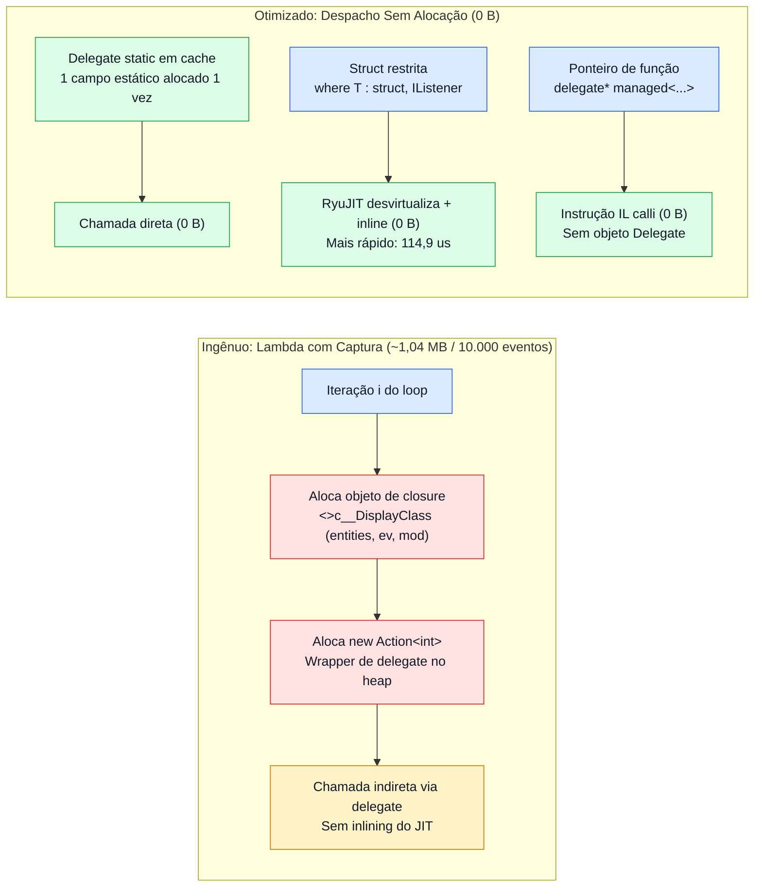

# Cache de Delegates e Despacho de Eventos Sem Alocação em C#

## Índice

- [Introdução](#introdução)
- [O Que Realmente Acontece por Baixo dos Panos?](#o-que-realmente-acontece-por-baixo-dos-panos)
- [Passo a Passo do Código](#passo-a-passo-do-código)
  - [1. Lambdas com Captura (Ingênuo)](#1-lambdas-com-captura-ingênuo)
  - [2. Delegates `static` em Cache com Estado Explícito](#2-delegates-static-em-cache-com-estado-explícito)
  - [3. Despacho Genérico Restrito por Interface](#3-despacho-genérico-restrito-por-interface)
  - [4. Ponteiros de Função Gerenciados (`delegate*`) do C# 9](#4-ponteiros-de-função-gerenciados-delegate-do-c-9)
- [Resultados do Benchmark](#resultados-do-benchmark)
- [Armadilhas Comuns e Quando NÃO Usar](#armadilhas-comuns-e-quando-não-usar)
- [Como Diagnosticar Alocações de Delegates](#como-diagnosticar-alocações-de-delegates)
- [Tabela Resumo Comparativa](#tabela-resumo-comparativa)

---

## Introdução

Passar lambdas inline para despachantes de eventos parece natural e conciso:

```csharp
InvokeCallback(ev.EntityIndex, index =>
{
    EntityState.ApplyCombatEvent(ref entities[index], in ev, globalModifier);
});
```

Quando isso executa uma vez no clique de um botão, a alocação é irrelevante. Porém, quando executa para **10.000 eventos de gameplay por frame**, o compilador C# não consegue reutilizar o delegate porque `ev`, `entities` e `globalModifier` mudam a cada iteração. Cada evento aloca uma classe de closure e um novo `Action<int>` no heap gerenciado.

---

## O Que Realmente Acontece por Baixo dos Panos?

Quando uma lambda captura variáveis locais ou `this`, o Roslyn (o compilador C#) gera uma classe de closure oculta no heap (`<>c__DisplayClass`) para guardar essas variáveis e instancia `new Action<int>(displayClass.<Method>b__0)` a cada iteração.



Em contraste:
1. **Lambdas `static`** (`static (...) => ...`) têm garantia do compilador de não capturar **nada** e ficam em cache em um único campo estático oculto.
2. **Listeners em `struct` genérica restrita** (`where TListener : struct, IGameplayEventListener`) permitem ao **RyuJIT** (compilador JIT do .NET) **desvirtualizar** a chamada (resolver o método concreto da struct na compilação, evitando busca de interface) e aplicar *inlining* direto no loop.
3. **`delegate* managed<...>`** emite uma instrução IL **`calli`** (chamada indireta por endereço bruto de função), sem nenhum objeto `Delegate` no heap.

---

## Passo a Passo do Código

### 1. Lambdas com Captura (Ingênuo)

Em [EventDispatcher.cs](../Data/EventDispatcher.cs), `DispatchCapturingLambda` captura `entities`, `ev` e `globalModifier`:

```csharp
for (int i = 0; i < events.Length; i++)
{
    CombatEvent ev = events[i];
    ValidateIndex(ev.EntityIndex, entities.Length);
    InvokeCallback(ev.EntityIndex, index =>
    {
        EntityState.ApplyCombatEvent(ref entities[index], in ev, globalModifier);
    });
}
```

Cada evento aloca uma display class e um delegate, gerando `1.040.032 B` (`~1.04 MB`) em 10.000 eventos.

### 2. Delegates `static` em Cache com Estado Explícito

Ao mover o estado para a assinatura do delegate (`StaticEntityEventHandler`), a lambda `static` não captura nada e é alocada apenas uma vez:

```csharp
private static readonly StaticEntityEventHandler CachedHandler =
    static (ref EntityState entity, in CombatEvent ev, int globalModifier) =>
        EntityState.ApplyCombatEvent(ref entity, in ev, globalModifier);
```

### 3. Despacho Genérico Restrito por Interface

Quando o listener precisa carregar estado configurável (`_globalModifier`), armazená-lo em uma `readonly struct` que implementa `IGameplayEventListener` evita closures e habilita inlining pelo JIT:

```csharp
public static void DispatchInterfaceListener<TListener>(
    Span<EntityState> entities,
    ReadOnlySpan<CombatEvent> events,
    ref TListener listener)
    where TListener : struct, IGameplayEventListener
```

### 4. Ponteiros de Função Gerenciados (`delegate*`) do C# 9

Para sistemas de baixo nível que precisam apenas de um ponteiro de função sem objeto no heap:

```csharp
delegate* managed<ref EntityState, in CombatEvent, int, void> handler = &EntityState.ApplyCombatEvent;
handler(ref entities[ev.EntityIndex], in ev, globalModifier);
```

---

## Resultados do Benchmark

Medido com BenchmarkDotNet no .NET 9.0.22 (`--filter "*DelegateCaching*" --job short`) para 10.000 eventos:

| Método | Média | Mediana | Speedup (Média) | Alocado |
|---|---:|---:|---:|---:|
| `DispatchCapturingLambda` | 1,013.5 us | 542.8 us | 1.00x | 1,040,032 B |
| `DispatchCachedStaticDelegate` | 134.6 us | 136.4 us | 7.53x | **0 B** |
| `DispatchInterfaceListener` | **114.9 us** | **109.6 us** | **8.82x** | **0 B** |
| `DispatchFunctionPointer` | 269.1 us | 262.5 us | 3.77x | **0 B** |

---

## Armadilhas Comuns e Quando NÃO Usar

- **NÃO use `unsafe delegate*` em scripts de gameplay:** Prefira delegates `static` ou interfaces genéricas restritas a `struct`, reservando `delegate*` para interop nativo ou internals de engine.
- **Cuidado com conversões de method group em métodos de instância:** Escrever `Dispatch(this.HandleEvent)` ainda aloca um novo `Action` a cada chamada se não for guardado em campo.
- **Evite boxing de listeners `struct`:** Passar uma `struct` para um parâmetro não genérico `IGameplayEventListener` causa boxing no heap. Use sempre `<TListener> where TListener : struct, IGameplayEventListener`.

---

## Como Diagnosticar Alocações de Delegates

1. **Adicione `static` nas lambdas em caminhos críticos:** O compilador C# emite erro `CS8820` imediatamente se a lambda capturar alguma variável local ou `this`.
2. **Use `GC.GetAllocatedBytesForCurrentThread()` nos testes** ou `[MemoryDiagnoser]` no BenchmarkDotNet para garantir `0 B` alocados.

---

## Tabela Resumo Comparativa

| Estratégia | Memória Alocada (10.000 eventos) | Tempo Médio | JIT Inlining | Melhor Uso |
|---|---|---|---|---|
| Lambda com Captura | 1,040,032 B | 1,013.5 us | Não | Callbacks frios de UI e setup |
| Delegate `static` em Cache | **0 B** | 134.6 us | Não | APIs flexíveis de callback |
| Interface Genérica (`struct`) | **0 B** | **114.9 us** | **Sim** | Listeners com estado em loops quentes |
| Ponteiro `delegate*` | **0 B** | 269.1 us | Não | Internals de engine e interop |
