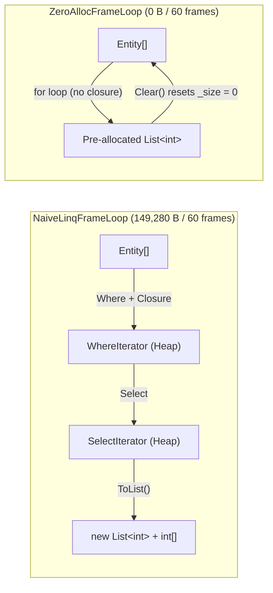

# Hot-Path Allocations (Zero-Allocation Update Loops)

## Table of Contents

- [Intuition: Why Per-Frame LINQ Breaks 60 FPS](#intuition-why-per-frame-linq-breaks-60-fps)
- [What LINQ Allocates Under the Hood](#what-linq-allocates-under-the-hood)
- [Naive vs. NonAlloc Walkthrough](#naive-vs-nonalloc-walkthrough)
- [Trade-offs and Pitfalls (When NOT to Use)](#trade-offs-and-pitfalls-when-not-to-use)
- [Profiling and Diagnostics](#profiling-and-diagnostics)
- [Summary and Benchmark Results](#summary-and-benchmark-results)

---

## Intuition: Why Per-Frame LINQ Breaks 60 FPS

Imagine a librarian who, every single minute, buys a brand-new notebook, copies down the IDs of every active book, reads the list once, and throws the notebook in the shredder. Even if each notebook is small, buying and shredding 60 notebooks per second creates a mountain of paper waste.

In a 60 FPS game loop (`Update()` in Unity or `_Process()` in Godot), your code has `16.6 ms` per frame. Calling `.Where(...).Select(...).ToList()` on every tick is that disposable-notebook habit: it looks clean on one line, but allocates iterator state machines, closure objects, and fresh `List<int>` backing arrays every frame. Across `1,000` entities over `60` frames in [Benchmark.md](../Benchmark.md), that generates `149,280 B` (`~145.8 KB`) of short-lived Gen0 garbage every second.

---

## What LINQ Allocates Under the Hood

Every chained LINQ call over an array or `IEnumerable<T>` hides multiple managed heap allocations:

1. **Closure display class**: Capturing a local variable like `minEnergy` inside `e => e.Active && e.Energy >= minEnergy` causes the C# compiler to allocate a hidden `<>c__DisplayClass` object on the heap (plus a `Func<Entity, bool>` delegate if not cached).
2. **Iterator objects**: `.Where(...)` and `.Select(...)` allocate `WhereArrayIterator<Entity>` and `SelectArrayIterator<Entity, int>` objects, and iterating via `IEnumerable<T>` boxes struct enumerators (`List<T>.Enumerator`) if typed as an interface.
3. **Result buffer growth**: `.ToList()` allocates a new `List<int>` and repeatedly allocates larger `int[]` backing arrays (`4 -> 8 -> 16 -> ... -> 1024`) as elements are appended.

```text
Naive LINQ (per frame):
  Heap: [DisplayClass] + [WhereIterator] + [SelectIterator] + [List<int>] + [int[] x N resizes]

NonAlloc Scratch Buffer (steady state):
  Setup: List<int> _scratchIds = new(1000)   (allocated once)
  Frame: _scratchIds.Clear() -> sets _size = 0, keeps int[1000] backing array -> 0 B allocated!
```



---

## Naive vs. NonAlloc Walkthrough

### 1. Naive LINQ Query (`HotPathQueries.QueryActiveNaive`)

In [HotPathQueries.cs](../Data/HotPathQueries.cs), `QueryActiveNaive` queries [EntityWorld.cs](../Data/EntityWorld.cs) using LINQ:

```csharp
public static List<int> QueryActiveNaive(Entity[] entities, float minEnergy)
{
    ArgumentNullException.ThrowIfNull(entities);
    return entities
        .Where(e => e.Active && e.Energy >= minEnergy)
        .Select(e => e.Id)
        .ToList();
}
```

When `RunNaiveLinqFrameLoop` calls this 60 times, each frame pays both the GC allocation tax and virtual interface dispatch (`MoveNext()` / `Current`) through the iterator chain.

### 2. Buffer Reuse & `Span<T>` (`HotPathQueries.QueryActiveNonAlloc`)

Mirroring Unity's `Physics.RaycastNonAlloc`, `QueryActiveNonAlloc` accepts a caller-owned `List<int>` pre-sized during setup (`new List<int>(EntityCount)`):

```csharp
public static void QueryActiveNonAlloc(Entity[] entities, float minEnergy, List<int> results)
{
    ArgumentNullException.ThrowIfNull(entities);
    ArgumentNullException.ThrowIfNull(results);

    results.Clear();
    for (int i = 0; i < entities.Length; i++)
    {
        Entity e = entities[i];
        if (e.Active && e.Energy >= minEnergy)
        {
            results.Add(e.Id);
        }
    }
}
```

`results.Clear()` resets the internal `_size` counter to `0` without releasing the backing `int[]` array. When you do not need to store results across calls, you can go even further with `Span<int>` (or `stackalloc int[count]` for small fixed bounds) to filter with zero heap buffers at all. Also note: iterating `List<T>` with `for (int i = 0; i < count; i++)` or `foreach` on concrete `List<T>` uses its struct enumerator (`0 B`), whereas passing `List<T>` as `IEnumerable<T>` boxes that enumerator onto the heap.

---

## Trade-offs and Pitfalls (When NOT to Use)

1. **Shared scratch buffer aliasing**: Reusing one `_scratchIds` field across nested or re-entrant calls causes the inner call's `Clear()` to wipe the outer loop's results. Never share a single scratch buffer across concurrent threads or re-entrant callbacks.
2. **Retained peak capacity**: If one rare spike adds 50,000 IDs to `_scratchIds`, `Clear()` keeps that `200 KB` `int[]` pinned forever. Call `TrimExcess()` only outside hot loops if peak spikes are rare.
3. **Stale references inside `List<T>` of classes**: Calling `Clear()` on `List<Entity>` zeroes element references so GC can collect them, whereas `List<int>` skips zeroing. Still, be mindful of holding large reference-type buffers longer than needed.
4. **When NOT to use**: In cold paths (startup loading, CLI tools, editor scripts, or one-off config parsing), LINQ is clearer, shorter, and fast enough. Optimize only verified hot paths.

---

## Profiling and Diagnostics

Verify zero-allocation hot loops with runtime counters and thread-local allocation checks:

```bash
# Monitor live allocation rate and Gen0 collections
dotnet-counters monitor --process-id <PID> --counters System.Runtime[alloc-rate,gen-0-gc-count]

# Run the HotPathAllocations BenchmarkDotNet suite with memory diagnoser
dotnet run --project CSharpLessons -c Release -- --filter "*HotPathAllocations*" --job short --memory
```

Assert zero allocations directly in tests using `GC.GetAllocatedBytesForCurrentThread()` (after JIT warmup):

```csharp
long before = GC.GetAllocatedBytesForCurrentThread();
HotPathQueries.RunZeroAllocFrameLoop(world, 60, 18f, scratchIds);
long allocated = GC.GetAllocatedBytesForCurrentThread() - before; // 0 B
```

Use **PerfView** (`GC Heap Alloc Stacks`) or `dotnet-trace` to spot hidden closure and iterator allocations (`<>c__DisplayClass`, `WhereArrayIterator`) in existing codebases.

---

## Summary and Benchmark Results

Measured on .NET 9.0.22 (AMD Ryzen 7 5800X, `1,000` entities over `60` frames) in [Benchmark.md](../Benchmark.md):

| Method | Mean | StdDev | Ratio | Gen0 | Allocated | Alloc Ratio |
|---|---:|---:|---:|---:|---:|---:|
| `NaiveLinqFrameLoop` | `242.01 us` | `3.962 us` | `1.00` | `8.7891` | `149,280 B` | `1.00` |
| `ZeroAllocFrameLoop` | `96.94 us` | `2.350 us` | `0.40` | `-` | `0 B` | `0.00` |

**Key takeaway**: Replacing per-frame LINQ with a reusable `List<int>` scratch buffer (`Clear()` + indexed `for` loop) cuts execution time by **`2.50x`** (`242.01 us` to `96.94 us`) and drops managed heap allocations from `149,280 B` to **`0 B`**.
