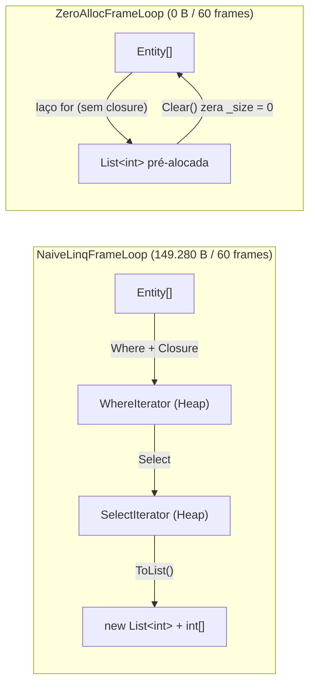

# Alocações no Hot Path (Loops de Atualização Zero-Allocation)

## Índice

- [Intuição: Por que LINQ por Frame Quebra os 60 FPS](#intuição-por-que-linq-por-frame-quebra-os-60-fps)
- [O que o LINQ Aloca por Baixo dos Panos](#o-que-o-linq-aloca-por-baixo-dos-panos)
- [Passo a Passo: LINQ Ingênuo vs. NonAlloc](#passo-a-passo-linq-ingênuo-vs-nonalloc)
- [Trade-offs e Armadilhas (Quando NÃO Usar)](#trade-offs-e-armadilhas-quando-não-usar)
- [Profiling e Diagnóstico](#profiling-e-diagnóstico)
- [Resumo e Resultados do Benchmark](#resumo-e-resultados-do-benchmark)

---

## Intuição: Por que LINQ por Frame Quebra os 60 FPS

Imagine um bibliotecário que, a cada minuto, compra um caderno novo, anota os códigos de todos os livros ativos, lê a lista uma única vez e joga o caderno no triturador. Mesmo que cada caderno seja fino, comprar e triturar 60 cadernos por segundo cria uma montanha de lixo.

Em um loop de jogo a 60 FPS (`Update()` na Unity ou `_Process()` na Godot), você tem apenas `16,6 ms` por frame. Chamar `.Where(...).Select(...).ToList()` a cada tick repete esse hábito do caderno descartável: parece limpo em uma linha, mas aloca iteradores, objetos de closure e novos arrays internos de `List<int>` em todo frame. Para `1.000` entidades durante `60` frames em [Benchmark.md](../Benchmark.md), isso gera `149.280 B` (`~145,8 KB`) de lixo temporário na Gen0 por segundo.

---

## O que o LINQ Aloca por Baixo dos Panos

Cada chamada encadeada de LINQ sobre um array ou `IEnumerable<T>` esconde várias alocações no heap gerenciado:

1. **Classe de closure**: Capturar uma variável local como `minEnergy` em `e => e.Active && e.Energy >= minEnergy` faz o compilador C# alocar uma classe oculta `<>c__DisplayClass` no heap.
2. **Objetos iteradores**: `.Where(...)` e `.Select(...)` instanciam `WhereArrayIterator<Entity>` e `SelectArrayIterator<Entity, int>`, e iterar via `IEnumerable<T>` faz boxing de enumeradores `struct` (`List<T>.Enumerator`) quando tipados pela interface.
3. **Crescimento do buffer final**: `.ToList()` aloca uma nova `List<int>` e realoca arrays internos (`4 -> 8 -> 16 -> ... -> 1024`) conforme os itens são inseridos.

```text
LINQ Ingênuo (por frame):
  Heap: [DisplayClass] + [WhereIterator] + [SelectIterator] + [List<int>] + [int[] x N]

Buffer Scratch NonAlloc (regime permanente):
  Setup: List<int> _scratchIds = new(1000)   (alocado 1 vez)
  Frame: _scratchIds.Clear() -> zera _size = 0, mantém int[1000] -> 0 B alocados!
```



---

## Passo a Passo: LINQ Ingênuo vs. NonAlloc

### 1. Consulta LINQ Ingênua (`HotPathQueries.QueryActiveNaive`)

Em [HotPathQueries.cs](../Data/HotPathQueries.cs), `QueryActiveNaive` consulta [EntityWorld.cs](../Data/EntityWorld.cs) usando LINQ:

```csharp
public static List<int> QueryActiveNaive(Entity[] entities, float minEnergy)
{
    ArgumentNullException.ThrowIfNull(entities);
    return entities
        .Where(e => e.Active && e.Energy >= minEnergy)
        .Select(e => e.Id)
        .ToList();
}
```

Quando `RunNaiveLinqFrameLoop` executa isso 60 vezes, cada frame paga o custo de alocação no GC e chamadas virtuais (`MoveNext()` / `Current`) na cadeia de iteradores.

### 2. Reúso de Buffer e `Span<T>` (`HotPathQueries.QueryActiveNonAlloc`)

Seguindo o padrão de `Physics.RaycastNonAlloc` na Unity, `QueryActiveNonAlloc` recebe uma `List<int>` pré-dimensionada na inicialização (`new List<int>(EntityCount)`):

```csharp
public static void QueryActiveNonAlloc(Entity[] entities, float minEnergy, List<int> results)
{
    ArgumentNullException.ThrowIfNull(entities);
    ArgumentNullException.ThrowIfNull(results);

    results.Clear();
    for (int i = 0; i < entities.Length; i++)
    {
        Entity e = entities[i];
        if (e.Active && e.Energy >= minEnergy)
        {
            results.Add(e.Id);
        }
    }
}
```

`results.Clear()` redefine o contador interno `_size` para `0` sem liberar o array `int[]` subjacente. Quando o resultado não precisa persistir entre chamadas, é possível ir além com `Span<int>` (ou `stackalloc int[count]` para limites pequenos) e filtrar sem nenhum buffer no heap. Vale lembrar também que percorrer `List<T>` com `for` indexado ou `foreach` no tipo concreto usa o enumerador `struct` (`0 B`), enquanto passar `List<T>` como `IEnumerable<T>` faz boxing no heap.

---

## Trade-offs e Armadilhas (Quando NÃO Usar)

1. **Aliasing de buffer compartilhado**: Reutilizar o mesmo campo `_scratchIds` em chamadas aninhadas ou reentrantes faz o `Clear()` interno apagar os resultados do loop externo. Nunca compartilhe um único buffer entre threads ou callbacks reentrantes.
2. **Capacidade retida após picos**: Se um pico raro inserir 50.000 IDs em `_scratchIds`, `Clear()` mantém esse array de `200 KB` retido indefinidamente. Use `TrimExcess()` fora do hot path apenas se picos extremos forem raros.
3. **Referências antigas em listas de classes**: `Clear()` em `List<Entity>` zera as referências para o GC coletar os objetos, enquanto `List<int>` evita zerar. Ainda assim, evite reter buffers enormes sem necessidade.
4. **Quando NÃO usar**: Em caminhos frios (carregamento inicial, ferramentas CLI, scripts de editor), LINQ é mais legível, conciso e suficientemente rápido. Otimize apenas hot paths comprovados.

---

## Profiling e Diagnóstico

Valide loops zero-allocation com contadores de runtime e medições por thread:

```bash
# Monitorar taxa de alocação e coletas Gen0 em tempo real
dotnet-counters monitor --process-id <PID> --counters System.Runtime[alloc-rate,gen-0-gc-count]

# Executar o BenchmarkDotNet de HotPathAllocations com diagnóstico de memória
dotnet run --project CSharpLessons -c Release -- --filter "*HotPathAllocations*" --job short --memory
```

Garanta `0 B` alocados em testes automatizados com `GC.GetAllocatedBytesForCurrentThread()` (após aquecimento JIT):

```csharp
long before = GC.GetAllocatedBytesForCurrentThread();
HotPathQueries.RunZeroAllocFrameLoop(world, 60, 18f, scratchIds);
long allocated = GC.GetAllocatedBytesForCurrentThread() - before; // 0 B
```

Use **PerfView** (`GC Heap Alloc Stacks`) ou `dotnet-trace` para localizar alocações ocultas de closures e iteradores (`<>c__DisplayClass`, `WhereArrayIterator`).

---

## Resumo e Resultados do Benchmark

Medido no .NET 9.0.22 (AMD Ryzen 7 5800X, `1.000` entidades em `60` frames) em [Benchmark.md](../Benchmark.md):

| Método | Média | Desvio Padrão | Razão | Gen0 | Alocado | Razão de Alocação |
|---|---:|---:|---:|---:|---:|---:|
| `NaiveLinqFrameLoop` | `242,01 us` | `3,962 us` | `1,00` | `8,7891` | `149.280 B` | `1,00` |
| `ZeroAllocFrameLoop` | `96,94 us` | `2,350 us` | `0,40` | `-` | `0 B` | `0,00` |

**Conclusão prática**: Substituir LINQ por frame por um buffer `List<int>` reutilizável (`Clear()` + laço `for` indexado) reduz o tempo em **`2,50x`** (`242,01 us` para `96,94 us`) e zera as alocações no heap (`149.280 B` para **`0 B`**).
