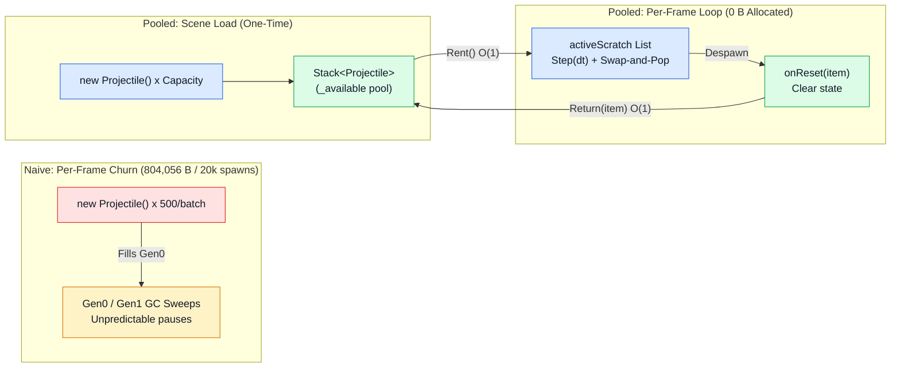

# Object Pooling in C#

## Table of Contents

- [Intuition: Why `new Projectile()` Causes Frame Spikes](#intuition-why-new-projectile-causes-frame-spikes)
- [Memory and GC Mechanics](#memory-and-gc-mechanics)
- [Naive vs. Pooled Walkthrough](#naive-vs-pooled-walkthrough)
- [Trade-offs and Pitfalls (When NOT to Use)](#trade-offs-and-pitfalls-when-not-to-use)
- [Profiling and Diagnostics](#profiling-and-diagnostics)
- [Summary and Benchmark Results](#summary-and-benchmark-results)

---

## Intuition: Why `new Projectile()` Causes Frame Spikes

Imagine a busy kitchen where every time a customer orders soup, the chef buys a brand-new ceramic bowl, serves the soup, and throws the bowl into a dumpster when the customer finishes. Buying a bowl is fast at first, until the dumpster overflows and the whole kitchen has to stop cooking while the staff hauls trash to the landfill.

In a 60 FPS game (`16.6 ms` frame budget) or 120 FPS simulation (`8.3 ms` budget), spawning hundreds of projectiles, particles, or hit markers per frame with `new Projectile()` is that disposable-bowl kitchen. Even though .NET 9's **bump-pointer allocator** (which allocates new objects by simply advancing a memory pointer) makes a single `new` cheap, sustained churn (`~804 KB` per `20,000` spawns in [Benchmark.md](../Benchmark.md)) fills Generation 0 (Gen0) repeatedly, triggering Gen0 and Gen1 Garbage Collector (GC) sweeps that compete directly with your frame budget.

---

## Memory and GC Mechanics

Every `Projectile` instance lives on the managed heap with a 16-byte .NET object header and MethodTable pointer (the runtime type descriptor) plus its 24 bytes of fields (`X`, `Y`, `Vx`, `Vy`, `RemainingFrames`, `Active`), totaling `40 bytes` per object on 64-bit .NET. Without pooling, each spawn advances the Gen0 allocation pointer; once Gen0 fills, the GC pauses managed threads to trace live references and compact dead memory.

```text
Naive (per-frame churn):
  Gen0 Heap: [Proj#1][Proj#2][Proj#3]...[Proj#500] ---> Gen0 Full ---> GC Pause!

Pooled (steady-state reuse):
  Scene Load: Stack<Projectile> [Ptr0, Ptr1, ..., Ptr499]  (allocated once)
  Runtime:    Rent() -> Pop() -> Activate() -> Step() -> Reset() -> Return() -> Push()
```



---

## Naive vs. Pooled Walkthrough

### 1. Naive Allocation (`ProjectileSimulation.RunNaive`)

In [ProjectileSimulation.cs](../Data/ProjectileSimulation.cs), `RunNaive` allocates a new `List<Projectile>` and calls `new Projectile()` for every spawn across every batch:

```csharp
var p = new Projectile();
p.Activate(i * 0.5f, 0f, 10f, 5f, lifetimeFrames);
active.Add(p);
```

When `p.Step(dt)` returns `false`, the projectile is removed from `active` using **swap-and-pop** (`active[i] = active[last]; active.RemoveAt(last);`) and abandoned for the GC to collect later.

### 2. Pre-Allocated `ObjectPool<T>` (`ProjectileSimulation.RunPooled`)

[ObjectPool.cs](../Data/ObjectPool.cs) implements [IObjectPool.cs](../Data/IObjectPool.cs) by pre-allocating `capacity` instances into a `Stack<T>` during setup:

```csharp
public T Rent()
{
    if (_available.Count == 0)
        throw new InvalidOperationException("Object pool exhausted.");
    ActiveCount++;
    return _available.Pop();
}

public void Return(T item)
{
    ArgumentNullException.ThrowIfNull(item);
    if (_available.Count >= Capacity)
        throw new InvalidOperationException("Cannot return item to a full pool.");
    _onReset(item);
    _available.Push(item);
    ActiveCount--;
}
```

In `RunPooled`, `Rent()` pops a warm `Projectile` in $O(1)$ with `0 B` allocated, and `Return(p)` invokes `p.Reset()` before pushing it back. Combined with swap-and-pop on a caller-owned `activeScratch` list, both spawning and despawning stay $O(1)$ without shifting elements or allocating memory.

---

## Trade-offs and Pitfalls (When NOT to Use)

1. **Dirty-state reset bugs**: If `Reset()` forgets even one field (such as a velocity, timer, or event handler), recycled objects inherit ghost state from their previous life. Always reset every mutable field inside `onReset`.
2. **Double-return corruption**: Returning the same reference twice pushes duplicate pointers onto `_available`, causing two callers to mutate the same object simultaneously. Guard with capacity/state checks or track `Active`.
3. **Retained memory footprint**: A pool sized for peak load (`Capacity = 500`) keeps all 500 objects pinned in memory for the lifetime of the pool, potentially promoting them to Gen2.
4. **Thread contention**: `ObjectPool<T>` uses a plain `Stack<T>` and is not thread-safe. For multi-threaded producers/consumers, use `Microsoft.Extensions.ObjectPool.DefaultObjectPool<T>`, `ConcurrentBag<T>`, or thread-local pools—though lock/CAS overhead can outweigh pooling for tiny objects.
5. **When NOT to use**: Do not pool tiny, short-lived objects in cold paths or when `struct` / `stackalloc` can eliminate heap allocation altogether.

---

## Profiling and Diagnostics

Measure allocation rates and GC pauses before and after introducing a pool:

```bash
# Live GC heap size, Gen0/1/2 counts, and allocation rate per second
dotnet-counters monitor --process-id <PID> --counters System.Runtime[alloc-rate,gen-0-gc-count,gen-1-gc-count,time-in-gc]

# Run this lesson's BenchmarkDotNet suite with memory diagnostics
dotnet run --project CSharpLessons -c Release -- --filter "*ObjectPooling*" --job short --memory
```

In unit tests or micro-checks, assert zero steady-state allocations using `GC.GetAllocatedBytesForCurrentThread()`:

```csharp
long before = GC.GetAllocatedBytesForCurrentThread();
ProjectileSimulation.RunPooled(500, 10, 4, 0.016f, pool, scratch);
long allocated = GC.GetAllocatedBytesForCurrentThread() - before; // 0 B
```

For deep Gen0/Gen1 pause timelines, capture a trace with **PerfView** (`Collect -> GC Only`) or `dotnet-trace collect --profile gc-verbose`.

---

## Summary and Benchmark Results

Measured on .NET 9.0.22 (AMD Ryzen 7 5800X, `BatchSize = 500`, `LifetimeFrames = 4`) in [Benchmark.md](../Benchmark.md):

| Method | TotalSpawns | Mean | Gen0 | Gen1 | Allocated | Alloc Ratio |
|---|---:|---:|---:|---:|---:|---:|
| `NaiveSpawnAndDespawn` | `5,000` | `121.1 us` | `11.9629` | `0.4883` | `204,056 B` | `1.00` |
| `PooledRentAndReturn` | `5,000` | `116.9 us` | `-` | `-` | `0 B` | `0.00` |
| `NaiveSpawnAndDespawn` | `20,000` | `488.2 us` | `47.8516` | `1.9531` | `804,056 B` | `1.00` |
| `PooledRentAndReturn` | `20,000` | `508.1 us` | `-` | `-` | `0 B` | `0.00` |

**Key takeaway**: Pooling is about **frame-time predictability**, not microbenchmark raw speed. Eliminating `804,056 B` of Gen0/Gen1 churn per `20,000` spawns prevents unpredictable GC stop-the-world pauses in real applications with large live heaps.
