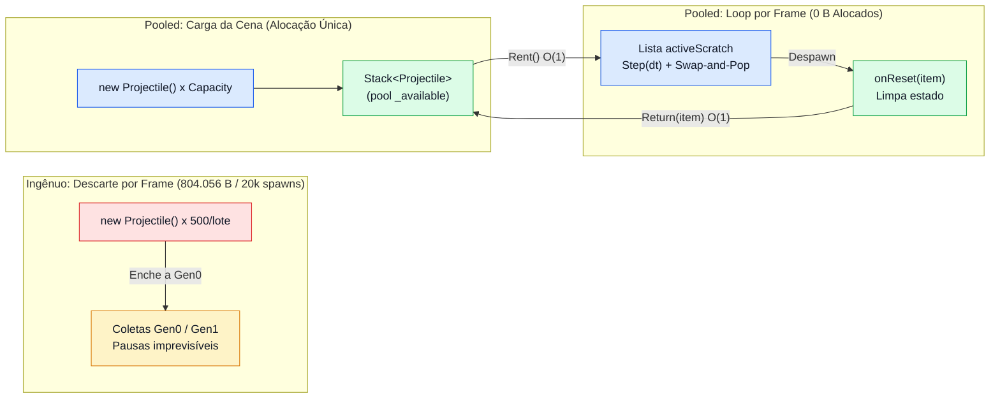

# Object Pooling em C#

## Índice

- [Intuição: Por que `new Projectile()` Gera Engasgos de Frame](#intuição-por-que-new-projectile-gera-engasgos-de-frame)
- [Mecânica de Memória e Garbage Collector](#mecânica-de-memória-e-garbage-collector)
- [Passo a Passo: Abordagem Ingênua vs. Pooled](#passo-a-passo-abordagem-ingênua-vs-pooled)
- [Trade-offs e Armadilhas (Quando NÃO Usar)](#trade-offs-e-armadilhas-quando-não-usar)
- [Profiling e Diagnóstico](#profiling-e-diagnóstico)
- [Resumo e Resultados do Benchmark](#resumo-e-resultados-do-benchmark)

---

## Intuição: Por que `new Projectile()` Gera Engasgos de Frame

Imagine uma cozinha movimentada em que, a cada pedido de sopa, o cozinheiro compra uma tigela de cerâmica nova, serve o cliente e joga a tigela no lixo quando ele termina. Comprar uma tigela é rápido no começo, até a lixeira encher e toda a cozinha precisar parar para levar o lixo ao aterro.

Em um jogo a 60 FPS (orçamento de `16,6 ms` por frame) ou simulação a 120 FPS (`8,3 ms`), criar centenas de projéteis ou partículas por frame com `new Projectile()` repete exatamente esse desperdício. Embora o alocador **bump-pointer** do .NET 9 (que aloca novos objetos apenas avançando um ponteiro de memória) torne cada `new` isolado barato, o descarte contínuo (`~804 KB` a cada `20.000` disparos em [Benchmark.md](../Benchmark.md)) enche a Geração 0 (Gen0) rapidamente, forçando coletas Gen0 e Gen1 que disputam o orçamento do frame.

---

## Mecânica de Memória e Garbage Collector

Cada instância de `Projectile` vive no heap gerenciado com 16 bytes de cabeçalho .NET + ponteiro de MethodTable (o descritor de tipo em runtime), somados aos 24 bytes de campos (`X`, `Y`, `Vx`, `Vy`, `RemainingFrames`, `Active`), totalizando `40 bytes` por objeto em .NET 64 bits. Sem pooling, cada disparo avança o ponteiro de alocação da Gen0; quando a Gen0 lota, o GC pausa as threads gerenciadas para rastrear referências vivas e compactar o lixo.

```text
Abordagem Ingênua (descarte por frame):
  Heap Gen0: [Proj#1][Proj#2][Proj#3]...[Proj#500] ---> Gen0 Lotada ---> Pausa de GC!

Com Pool (reúso em regime permanente):
  Carga da Cena: Stack<Projectile> [Ptr0, Ptr1, ..., Ptr499]  (alocado 1 vez)
  Execução:      Rent() -> Pop() -> Activate() -> Step() -> Reset() -> Return() -> Push()
```



---

## Passo a Passo: Abordagem Ingênua vs. Pooled

### 1. Alocação Ingênua (`ProjectileSimulation.RunNaive`)

Em [ProjectileSimulation.cs](../Data/ProjectileSimulation.cs), `RunNaive` cria uma nova `List<Projectile>` e chama `new Projectile()` para cada disparo em todos os lotes:

```csharp
var p = new Projectile();
p.Activate(i * 0.5f, 0f, 10f, 5f, lifetimeFrames);
active.Add(p);
```

Quando `p.Step(dt)` retorna `false`, o projétil é removido de `active` via **swap-and-pop** (`active[i] = active[last]; active.RemoveAt(last);`) e abandonado para o GC coletar depois.

### 2. `ObjectPool<T>` Pré-Alocado (`ProjectileSimulation.RunPooled`)

[ObjectPool.cs](../Data/ObjectPool.cs) implementa [IObjectPool.cs](../Data/IObjectPool.cs) pré-alocando `capacity` instâncias em uma `Stack<T>` durante a inicialização:

```csharp
public T Rent()
{
    if (_available.Count == 0)
        throw new InvalidOperationException("Object pool exhausted.");
    ActiveCount++;
    return _available.Pop();
}

public void Return(T item)
{
    ArgumentNullException.ThrowIfNull(item);
    if (_available.Count >= Capacity)
        throw new InvalidOperationException("Cannot return item to a full pool.");
    _onReset(item);
    _available.Push(item);
    ActiveCount--;
}
```

Em `RunPooled`, `Rent()` retira um `Projectile` pronto em $O(1)$ com `0 B` alocados, e `Return(p)` executa `p.Reset()` antes de devolvê-lo à pilha. Junto ao swap-and-pop no buffer `activeScratch`, tanto o spawn quanto o despawn permanecem em $O(1)$ sem deslocar elementos nem alocar memória.

---

## Trade-offs e Armadilhas (Quando NÃO Usar)

1. **Bugs de estado residual**: Se `Reset()` esquecer qualquer campo (como velocidade, temporizador ou evento), objetos reciclados herdam estado fantasma do uso anterior. Sempre limpe todos os campos mutáveis em `onReset`.
2. **Devolução duplicada**: Chamar `Return(item)` duas vezes para a mesma referência coloca ponteiros duplicados em `_available`, fazendo dois sistemas alterarem o mesmo objeto ao mesmo tempo.
3. **Memória retida**: Um pool dimensionado para o pico (`Capacity = 500`) mantém os 500 objetos vivos na memória durante toda a cena, podendo promovê-los para a Gen2.
4. **Contenção entre threads**: `ObjectPool<T>` usa `Stack<T>` simples e não é thread-safe. Em cenários concorrentes, considere `DefaultObjectPool<T>`, `ConcurrentBag<T>` ou pools por thread — lembrando que o custo de sincronização pode anular o ganho para objetos pequenos.
5. **Quando NÃO usar**: Evite pooling para objetos minúsculos em caminhos frios ou quando `struct` / `stackalloc` eliminam a alocação no heap por completo.

---

## Profiling e Diagnóstico

Meça a taxa de alocação e as pausas de GC antes e depois de introduzir o pool:

```bash
# Taxa de alocação por segundo e contadores de Gen0/1/2 em tempo real
dotnet-counters monitor --process-id <PID> --counters System.Runtime[alloc-rate,gen-0-gc-count,gen-1-gc-count,time-in-gc]

# Executar o BenchmarkDotNet desta lição com diagnóstico de memória
dotnet run --project CSharpLessons -c Release -- --filter "*ObjectPooling*" --job short --memory
```

Em testes unitários, valide `0 B` alocados em regime permanente com `GC.GetAllocatedBytesForCurrentThread()`:

```csharp
long before = GC.GetAllocatedBytesForCurrentThread();
ProjectileSimulation.RunPooled(500, 10, 4, 0.016f, pool, scratch);
long allocated = GC.GetAllocatedBytesForCurrentThread() - before; // 0 B
```

Para investigar linhas do tempo de pausas Gen0/Gen1, colete traces no **PerfView** (`Collect -> GC Only`) ou via `dotnet-trace collect --profile gc-verbose`.

---

## Resumo e Resultados do Benchmark

Medido no .NET 9.0.22 (AMD Ryzen 7 5800X, `BatchSize = 500`, `LifetimeFrames = 4`) em [Benchmark.md](../Benchmark.md):

| Método | TotalSpawns | Média | Gen0 | Gen1 | Alocado | Razão de Alocação |
|---|---:|---:|---:|---:|---:|---:|
| `NaiveSpawnAndDespawn` | `5.000` | `121,1 us` | `11,9629` | `0,4883` | `204.056 B` | `1,00` |
| `PooledRentAndReturn` | `5.000` | `116,9 us` | `-` | `-` | `0 B` | `0,00` |
| `NaiveSpawnAndDespawn` | `20.000` | `488,2 us` | `47,8516` | `1,9531` | `804.056 B` | `1,00` |
| `PooledRentAndReturn` | `20.000` | `508,1 us` | `-` | `-` | `0 B` | `0,00` |

**Conclusão prática**: Object pooling entrega **previsibilidade de frame time**, não necessariamente menor tempo bruto em microbenchmarks isolados. Eliminar `804.056 B` de lixo Gen0/Gen1 a cada `20.000` disparos evita pausas imprevisíveis de GC em aplicações reais com heap grande.
