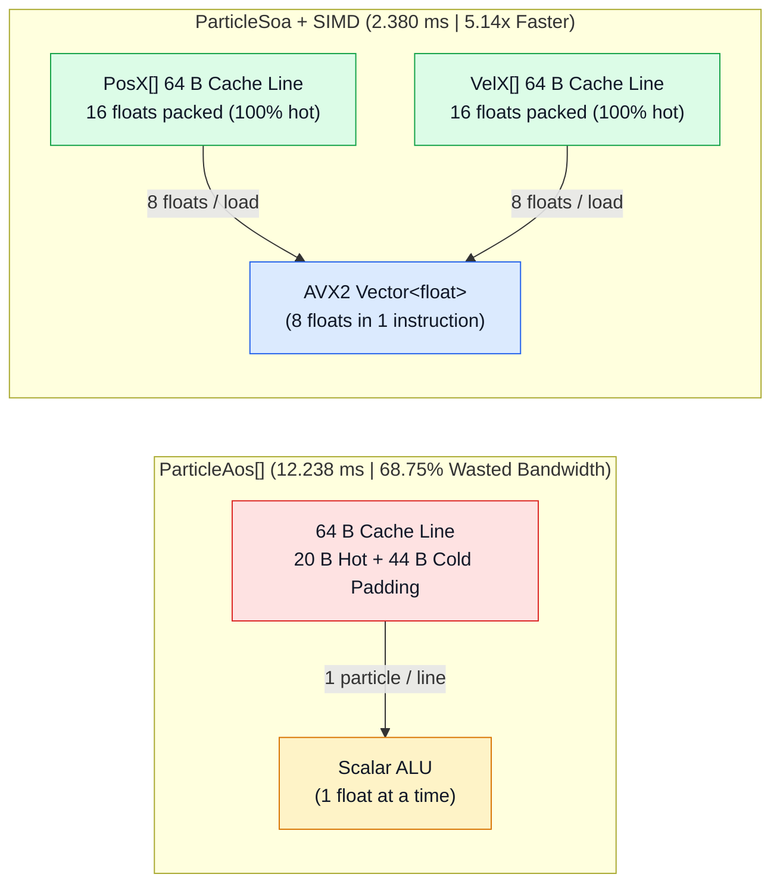

# SoA vs AoS with SIMD (`System.Numerics.Vector<float>`)

## Table of Contents

- [Intuition: Packing Boxes by Weight vs. Color](#intuition-packing-boxes-by-weight-vs-color)
- [Cache-Line Utilization and SIMD Mechanics](#cache-line-utilization-and-simd-mechanics)
- [Step-by-Step: AoS vs. SoA Scalar vs. SoA SIMD](#step-by-step-aos-vs-soa-scalar-vs-soa-simd)
- [Trade-offs and Pitfalls (When NOT to Use)](#trade-offs-and-pitfalls-when-not-to-use)
- [Profiling and Diagnostics](#profiling-and-diagnostics)
- [Summary and Benchmark Results](#summary-and-benchmark-results)

---

## Intuition: Packing Boxes by Weight vs. Color

Suppose you are a shipping clerk who only needs to update the **weight** of 100,000 items. In an **Array of Structures (AoS)** warehouse, every shelf crate holds one item's weight, dimensions, color, barcode, and invoice—all mixed together. Even though you only care about the weight, you still have to haul the entire 64-byte crate onto your desk for every item.

In a **Structure of Arrays (SoA)** warehouse, all 100,000 weights sit together in one aisle, all colors in another, and all invoices in a third. When you grab a tray (a 64-byte CPU cache line) from the weight aisle, you get **16 weights at once**—zero wasted space. Better yet, with **SIMD** (Single Instruction, Multiple Data), your hands can update **8 weights in a single CPU instruction** (`AVX2` `Vector<float>`).

---

## Cache-Line Utilization and SIMD Mechanics

In [ParticleAos.cs](../Data/ParticleAos.cs), each particle is `64 bytes`—matching one full x86-64 cache line:
- **Hot physics fields** (`X, Y, Vx, Vy, Life`): `20 bytes` (`31.25%`)
- **Cold rendering/metadata fields** (`R, G, B, A, Flags, MetadataA/B/C, Padding`): `44 bytes` (`68.75%`)

Every cache line fetched during physics integration wastes **68.75% of memory bandwidth** on cold bytes, and non-contiguous `X` fields prevent direct vector loads. In [ParticleSoa.cs](../Data/ParticleSoa.cs), splitting fields into parallel `float[]` channels (`PosX`, `PosY`, `VelX`, `VelY`, `Life`) achieves **100% cache-line density** (16 floats per 64-byte line) and unlocks 256-bit AVX2 `Vector<float>` operations (`Vector<float>.Count == 8`).

```text
AoS (64 B per ParticleAos - 1 particle per cache line):
  [ X | Y | Vx | Vy | Life | R | G | B | A | Flags | MetadataA..C | Pad ]
  |<------- 20B Hot ------>|<---------------- 44B Cold ---------------->|

SoA (64 B cache line in PosX[] - 16 particles per cache line):
  [ X0 | X1 | X2 | X3 | X4 | X5 | X6 | X7 | X8 | X9 | X10 | ... | X15 ]
  |<--------- 1 AVX2 Vector<float> (8 floats) --------->|
```



---

## Step-by-Step: AoS vs. SoA Scalar vs. SoA SIMD

### 1. Array of Structures (`ParticleIntegrator.IntegrateAos`)

In [ParticleIntegrator.cs](../Data/ParticleIntegrator.cs), `IntegrateAos` updates `ParticleAos[]` using `ref ParticleAos p = ref particles[i];`. Even without heap pointer chasing, 44 cold bytes pollute every cache line, taking `12.238 ms` for `100,000` particles over `60` frames.

### 2. Structure of Arrays Scalar (`ParticleIntegrator.IntegrateSoaScalar`)

Hoisting channel array references (`float[] px = soa.PosX;`) and looping linearly:

```csharp
for (int i = 0; i < n; i++)
{
    px[i] += vx[i] * dt;
    py[i] += vy[i] * dt;
    life[i] -= dt;
}
```

Just separating hot channels doubles throughput to `6.020 ms` (**`2.03x` faster**) because every byte loaded into L1 cache is useful physics data.

### 3. Structure of Arrays + SIMD (`ParticleIntegrator.IntegrateSoaSimd`)

```csharp
int width = Vector<float>.Count;
int simdLimit = n - (n % width);
var dtVec = new Vector<float>(dt);

int i = 0;
for (; i < simdLimit; i += width)
{
    var xVec = new Vector<float>(px, i) + new Vector<float>(vx, i) * dtVec;
    var yVec = new Vector<float>(py, i) + new Vector<float>(vy, i) * dtVec;
    var lVec = new Vector<float>(life, i) - dtVec;
    xVec.CopyTo(px, i);
    yVec.CopyTo(py, i);
    lVec.CopyTo(life, i);
}
for (; i < n; i++)
{
    px[i] += vx[i] * dt;
    py[i] += vy[i] * dt;
    life[i] -= dt;
}
```

Each iteration updates `8` particles simultaneously (`2.380 ms`, **`5.14x` faster** than AoS), and the scalar tail loop handles any remainder when `n` is not divisible by `Vector<float>.Count`.

---

## Trade-offs and Pitfalls (When NOT to Use)

1. **Forgetting the scalar tail loop**: If `Count` is not a multiple of `Vector<float>.Count` (e.g., `100` on AVX2 where `Count == 8`), skipping the tail loop silently leaves the last `n % width` elements un-updated.
2. **Random single-entity access**: Looking up one particle `i` across 6 separate arrays touches 6 different cache lines instead of 1. SoA shines on **batch scans** over many entities, not random single-record reads.
3. **Branching inside SIMD loops**: Heavy `if/else` per-element logic breaks vectorization unless converted to branchless masks (`Vector.ConditionalSelect`).
4. **When NOT to use**: For small entity counts (`< 100`), heavily branched business logic, or OOP domain models where all fields of one object are always accessed together.

---

## Profiling and Diagnostics

Inspect generated AVX2 assembly and measure throughput with BenchmarkDotNet:

```bash
# Run SoaVsAos benchmark with memory and JIT disassembly output
dotnet run --project CSharpLessons -c Release -- --filter "*SoaVsAos*" --job short --memory --disasm

# Verify zero steady-state allocations during integration
dotnet-counters monitor --process-id <PID> --counters System.Runtime[alloc-rate]
```

Check `BenchmarkDotNet.Artifacts/results/` after `--disasm` to confirm RyuJIT emits `vmulps` / `vaddps` vector instructions and eliminates array bounds checks inside the main loop.

---

## Summary and Benchmark Results

Measured on .NET 9.0.22 (AMD Ryzen 7 5800X, AVX2 `Vector<float>.Count == 8`, `100,000` particles x `60` frames) in [Benchmark.md](../Benchmark.md):

| Method | Mean | StdDev | Ratio | Speedup vs AoS |
|---|---:|---:|---:|---:|
| `IntegrateAos` (`ParticleAos[]`, `64 B` struct) | `12.238 ms` | `1.298 ms` | `1.00` | `1.00x` |
| `IntegrateSoaScalar` (`ParticleSoa`, scalar) | `6.020 ms` | `0.312 ms` | `0.50` | `2.03x` faster |
| `IntegrateSoaSimd` (`ParticleSoa`, `Vector<float>`) | `2.380 ms` | `0.187 ms` | `0.20` | `5.14x` faster |

**Key takeaway**: Moving from AoS to SoA eliminates cold-field cache pollution (`2.03x` faster), and pairing SoA with `Vector<float>` SIMD unlocks **`5.14x`** total speedup on modern CPUs.
