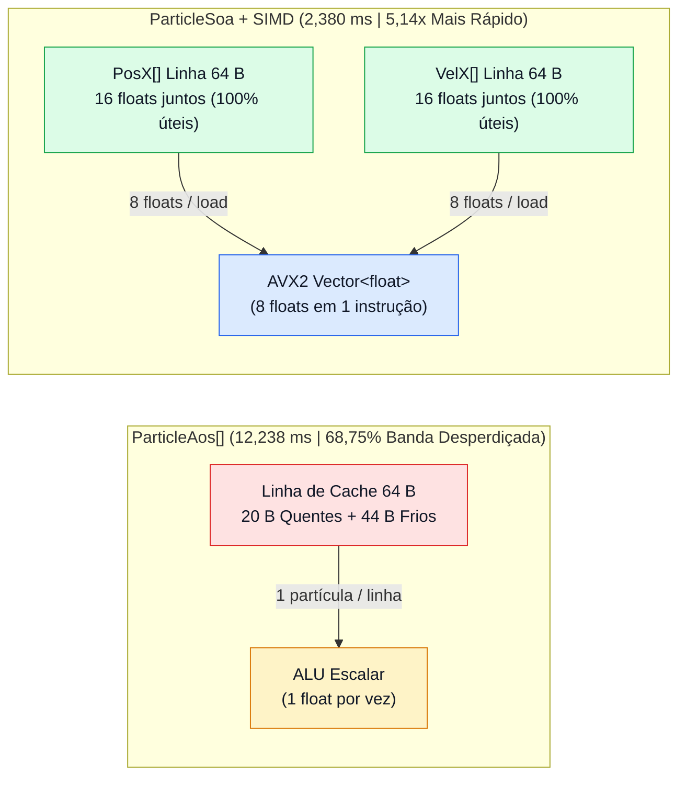

# SoA vs AoS com SIMD (`System.Numerics.Vector<float>`)

## Índice

- [Intuição: Organizando Caixas por Peso vs. Tudo Misturado](#intuição-organizando-caixas-por-peso-vs-tudo-misturado)
- [Uso da Linha de Cache e Mecânica SIMD](#uso-da-linha-de-cache-e-mecânica-simd)
- [Passo a Passo: AoS vs. SoA Escalar vs. SoA SIMD](#passo-a-passo-aos-vs-soa-escalar-vs-soa-simd)
- [Trade-offs e Armadilhas (Quando NÃO Usar)](#trade-offs-e-armadilhas-quando-não-usar)
- [Profiling e Diagnóstico](#profiling-e-diagnóstico)
- [Resumo e Resultados do Benchmark](#resumo-e-resultados-do-benchmark)

---

## Intuição: Organizando Caixas por Peso vs. Tudo Misturado

Imagine um operador de logística que precisa atualizar apenas o **peso** de 100.000 itens. Em um galpão **Array of Structures (AoS)**, cada caixa contém peso, dimensões, cor, código de barras e nota fiscal misturados. Mesmo precisando só do peso, você é obrigado a carregar a caixa inteira de 64 bytes até a bancada para cada item.

Em um galpão **Structure of Arrays (SoA)**, todos os 100.000 pesos ficam juntos em um corredor, todas as cores em outro e as notas fiscais em um terceiro. Quando você pega uma bandeja (uma linha de cache de 64 bytes) do corredor de pesos, recebe **16 pesos de uma só vez** — sem desperdício. Melhor ainda: com **SIMD** (Single Instruction, Multiple Data), você atualiza **8 pesos em uma única instrução da CPU** (`AVX2` `Vector<float>`).

---

## Uso da Linha de Cache e Mecânica SIMD

Em [ParticleAos.cs](../Data/ParticleAos.cs), cada partícula ocupa `64 bytes` — exatamente uma linha de cache x86-64:
- **Campos quentes de física** (`X, Y, Vx, Vy, Life`): `20 bytes` (`31,25%`)
- **Campos frios de renderização/metadados** (`R, G, B, A, Flags, MetadataA/B/C, Padding`): `44 bytes` (`68,75%`)

Cada linha de cache carregada na integração desperdiça **68,75% da banda de memória** com bytes frios e impede carregamentos vetoriais contíguos. Em [ParticleSoa.cs](../Data/ParticleSoa.cs), separar os canais em arrays `float[]` paralelos (`PosX`, `PosY`, `VelX`, `VelY`, `Life`) atinge **100% de densidade na linha de cache** (16 floats por linha de 64 B) e habilita instruções AVX2 de 256 bits (`Vector<float>.Count == 8`).

```text
AoS (64 B por ParticleAos - 1 partícula por linha de cache):
  [ X | Y | Vx | Vy | Life | R | G | B | A | Flags | MetadataA..C | Pad ]
  |<---- 20B Quentes ----->|<---------------- 44B Frios ---------------->|

SoA (linha de cache de 64 B em PosX[] - 16 partículas por linha):
  [ X0 | X1 | X2 | X3 | X4 | X5 | X6 | X7 | X8 | X9 | X10 | ... | X15 ]
  |<------- 1 Vector<float> AVX2 (8 floats) ------->|
```



---

## Passo a Passo: AoS vs. SoA Escalar vs. SoA SIMD

### 1. Array of Structures (`ParticleIntegrator.IntegrateAos`)

Em [ParticleIntegrator.cs](../Data/ParticleIntegrator.cs), `IntegrateAos` atualiza `ParticleAos[]` usando `ref ParticleAos p = ref particles[i];`. Mesmo sem pointer chasing no heap, 44 bytes frios poluem cada linha de cache, levando `12,238 ms` para `100.000` partículas em `60` frames.

### 2. Structure of Arrays Escalar (`ParticleIntegrator.IntegrateSoaScalar`)

Guardando referências locais dos arrays (`float[] px = soa.PosX;`) e iterando linearmente:

```csharp
for (int i = 0; i < n; i++)
{
    px[i] += vx[i] * dt;
    py[i] += vy[i] * dt;
    life[i] -= dt;
}
```

Apenas separar os canais quentes dobra o desempenho para `6,020 ms` (**`2,03x` mais rápido**), pois cada byte trazido para a cache L1 é dado útil de física.

### 3. Structure of Arrays + SIMD (`ParticleIntegrator.IntegrateSoaSimd`)

```csharp
int width = Vector<float>.Count;
int simdLimit = n - (n % width);
var dtVec = new Vector<float>(dt);

int i = 0;
for (; i < simdLimit; i += width)
{
    var xVec = new Vector<float>(px, i) + new Vector<float>(vx, i) * dtVec;
    var yVec = new Vector<float>(py, i) + new Vector<float>(vy, i) * dtVec;
    var lVec = new Vector<float>(life, i) - dtVec;
    xVec.CopyTo(px, i);
    yVec.CopyTo(py, i);
    lVec.CopyTo(life, i);
}
for (; i < n; i++)
{
    px[i] += vx[i] * dt;
    py[i] += vy[i] * dt;
    life[i] -= dt;
}
```

Cada iteração atualiza `8` partículas ao mesmo tempo (`2,380 ms`, **`5,14x` mais rápido** que AoS), e o loop escalar residual trata o restante quando `n` não é múltiplo de `Vector<float>.Count`.

---

## Trade-offs e Armadilhas (Quando NÃO Usar)

1. **Esquecer o loop escalar residual**: Se `Count` não for múltiplo de `Vector<float>.Count` (ex.: `100` em AVX2 onde `Count == 8`), omitir o loop residual deixa os últimos `n % width` elementos sem atualização.
2. **Acesso aleatório a uma única entidade**: Ler uma partícula isolada `i` em 6 arrays separados toca 6 linhas de cache diferentes em vez de 1. SoA brilha em **varreduras em lote**, não em leituras aleatórias individuais.
3. **Ramificações dentro do loop SIMD**: `if/else` pesado por elemento quebra a vetorização, exigindo máscaras sem branch (`Vector.ConditionalSelect`).
4. **Quando NÃO usar**: Para poucas entidades (`< 100`), regras com muitos desvios condicionais ou modelos OOP onde todos os campos de um objeto são lidos juntos.

---

## Profiling e Diagnóstico

Inspecione o assembly AVX2 gerado e meça a vazão com BenchmarkDotNet:

```bash
# Executar benchmark SoaVsAos com diagnóstico de memória e disassembly JIT
dotnet run --project CSharpLessons -c Release -- --filter "*SoaVsAos*" --job short --memory --disasm

# Confirmar zero alocações em regime permanente durante a integração
dotnet-counters monitor --process-id <PID> --counters System.Runtime[alloc-rate]
```

Verifique `BenchmarkDotNet.Artifacts/results/` após `--disasm` para confirmar instruções vetoriais `vmulps` / `vaddps` emitidas pelo RyuJIT e eliminação de checagem de limites no loop principal.

---

## Resumo e Resultados do Benchmark

Medido no .NET 9.0.22 (AMD Ryzen 7 5800X, AVX2 `Vector<float>.Count == 8`, `100.000` partículas x `60` frames) em [Benchmark.md](../Benchmark.md):

| Método | Média | Desvio Padrão | Razão | Ganho vs AoS |
|---|---:|---:|---:|---:|
| `IntegrateAos` (`ParticleAos[]`, struct `64 B`) | `12,238 ms` | `1,298 ms` | `1,00` | `1,00x` |
| `IntegrateSoaScalar` (`ParticleSoa`, escalar) | `6,020 ms` | `0,312 ms` | `0,50` | `2,03x` mais rápido |
| `IntegrateSoaSimd` (`ParticleSoa`, `Vector<float>`) | `2,380 ms` | `0,187 ms` | `0,20` | `5,14x` mais rápido |

**Conclusão prática**: Migrar de AoS para SoA elimina a poluição de cache por campos frios (`2,03x` mais rápido), e combinar SoA com SIMD `Vector<float>` entrega **`5,14x`** de ganho total em CPUs modernas.
