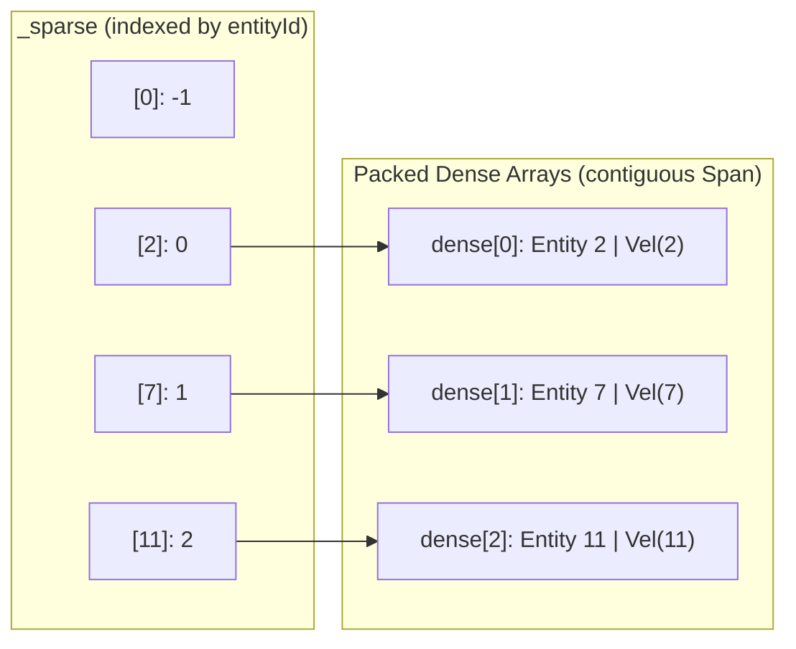

# ECS Sparse Set vs. `Dictionary<int, T>` in C#

## Table of Contents

- [Introduction](#introduction)
- [What Actually Happens Under the Hood?](#what-actually-happens-under-the-hood)
- [Step-by-Step Code Walkthrough](#step-by-step-code-walkthrough)
  - [The Naive Approach: `Dictionary<int, VelocityComponent>`](#the-naive-approach-dictionaryint-velocitycomponent)
  - [The Optimized Approach: `SparseSet<T>`](#the-optimized-approach-sparsesett)
- [Benchmark Results](#benchmark-results)
- [Common Pitfalls & When NOT to Use This](#common-pitfalls--when-not-to-use-this)
- [How to Diagnose Component Storage Bottlenecks](#how-to-diagnose-component-storage-bottlenecks)
- [Summary Comparison](#summary-comparison)

---

## Introduction

In game engines and Entity Component Systems (ECS), entities are represented by integer IDs and components (`VelocityComponent`, `Transform`, `Health`) are attached to only a subset of entities. Storing those components in a `Dictionary<int, VelocityComponent>` is convenient, but every lookup hashes the key, probes bucket chains, and leaves gaps or free-list chains when entities are removed.

A **`SparseSet<T>`** pairs a direct `entityId`-indexed lookup array with densely packed component and entity arrays, delivering $O(1)$ unhashed lookup, $O(1)$ swap-and-pop removal, and contiguous `Span<T>` iteration with zero GC allocations.

---

## What Actually Happens Under the Hood?

`SparseSet<T>` maintains three arrays:
1. `_sparse`: indexed by `entityId`, storing the element's position in the dense arrays (or `-1`).
2. `_denseEntities`: maps each dense slot `[0.._count-1]` back to its `entityId`.
3. `_denseComponents`: holds the active `T` structs contiguously in memory.



When removing entity `2`, `SparseSet<T>.Remove(2)` moves the last dense element (`Entity 11` at index `2`) into slot `0`, updates `_sparse[11] = 0`, marks `_sparse[2] = -1`, and decrements `_count`.

---

## Step-by-Step Code Walkthrough

### The Naive Approach: `Dictionary<int, VelocityComponent>`

In [DictionaryComponentStore.cs](../Data/DictionaryComponentStore.cs), `IntegrateAll` iterates `Dictionary<int, VelocityComponent>`. Every add/remove cycle hashes keys, resizes internal `Entry[]` and `int[] _buckets` arrays (`1,675,894 B` allocated in our 50,000-entity churn benchmark), and leaves unused slots in `_entries` when items are removed.

### The Optimized Approach: `SparseSet<T>`

In [SparseSet.cs](../Data/SparseSet.cs), `Remove` performs an $O(1)$ swap-and-pop while keeping `_denseComponents` packed:

```csharp
int removedDenseIndex = _sparse[entityId];
int lastDenseIndex = _count - 1;

if (removedDenseIndex != lastDenseIndex)
{
    int movedEntity = _denseEntities[lastDenseIndex];
    _denseEntities[removedDenseIndex] = movedEntity;
    _denseComponents[removedDenseIndex] = _denseComponents[lastDenseIndex];
    _sparse[movedEntity] = removedDenseIndex;
}

_sparse[entityId] = -1;
_count--;
```

Hot systems iterate directly over `Span<VelocityComponent> span = _sparseSet.AsDenseSpan()` with zero allocations and full hardware prefetching.

---

## Benchmark Results

Measured with BenchmarkDotNet on .NET 9.0.22 (`--filter "*SparseSet*" --job short`) across 50,000 entities:

| Method | Mean | Speedup | Allocated |
|---|---:|---:|---:|
| `DictionaryIterateAndLookup` | 1,637.0 us | 1.00x | 0 B |
| `SparseSetIterateAndLookup` | **1,037.6 us** | **1.58x** | 0 B |
| `DictionaryAddAndRemoveChurn` | 1,291.1 us | 1.00x | 1,675,894 B |
| `SparseSetAddAndRemoveChurn` | **229.4 us** | **5.63x** | **0 B** |

---

## Common Pitfalls & When NOT to Use This

- **Do NOT index `_sparse` with unbounded random IDs or GUIDs:** `_sparse` has length `maxEntityId + 1`. Pair `SparseSet<T>` with recycled dense integer entity IDs or paged sparse arrays.
- **Swap-and-pop changes iteration order:** Never depend on insertion order after calling `Remove()`.
- **Guard capacity:** Pre-size `SparseSet<T>` or grow `_dense*` arrays outside frame-critical loops.

---

## How to Diagnose Component Storage Bottlenecks

1. **Check `[MemoryDiagnoser]` for `Dictionary` bucket/entry allocations** during spawn/despawn bursts.
2. **Use `GC.GetAllocatedBytesForCurrentThread()` in tests** to confirm `AsDenseSpan()` loops allocate `0 B`.

---

## Summary Comparison

| Criterion | `Dictionary<int, T>` | `SparseSet<T>` |
|---|---|---|
| Lookup | $O(1)$ hashed + bucket probe | **$O(1)$ direct array index** |
| Iteration | Scans entry array with gaps | **Contiguous `Span<T>`** |
| Removal | Free-list entry unlink | **$O(1)$ swap-and-pop** |
| Churn allocation (50k ops) | 1,675,894 B (Gen0/1/2) | **0 B** |
