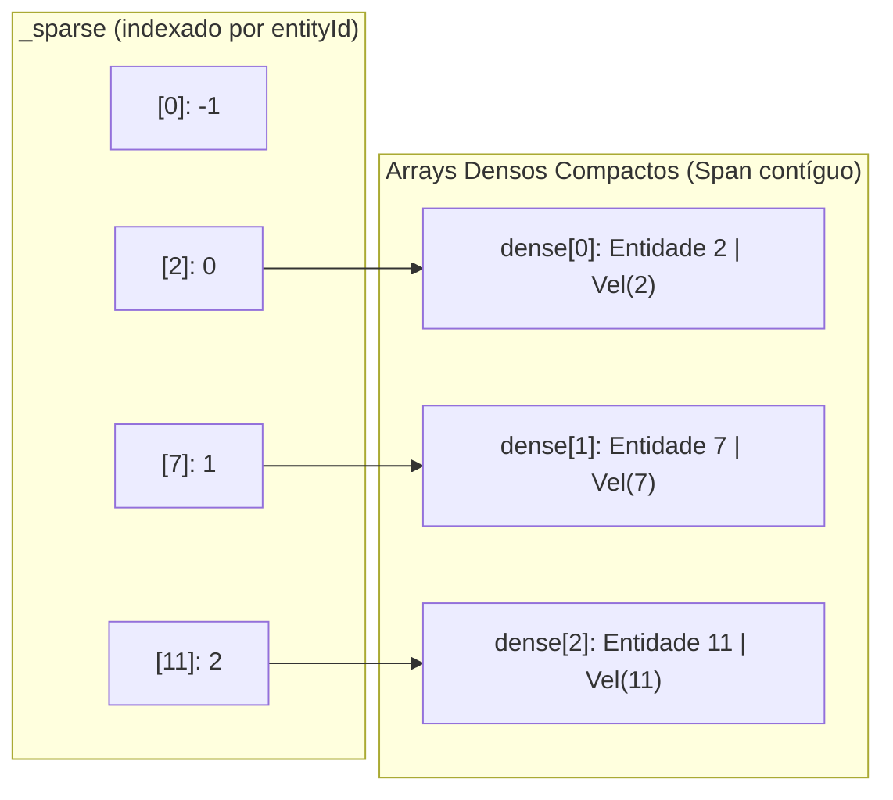

# Sparse Set para ECS vs. `Dictionary<int, T>` em C#

## Índice

- [Introdução](#introdução)
- [O Que Realmente Acontece por Baixo dos Panos?](#o-que-realmente-acontece-por-baixo-dos-panos)
- [Passo a Passo do Código](#passo-a-passo-do-código)
  - [Abordagem Ingênua: `Dictionary<int, VelocityComponent>`](#abordagem-ingênua-dictionaryint-velocitycomponent)
  - [Abordagem Otimizada: `SparseSet<T>`](#abordagem-otimizada-sparsesett)
- [Resultados do Benchmark](#resultados-do-benchmark)
- [Armadilhas Comuns e Quando NÃO Usar](#armadilhas-comuns-e-quando-não-usar)
- [Como Diagnosticar Gargalos de Armazenamento de Componentes](#como-diagnosticar-gargalos-de-armazenamento-de-componentes)
- [Tabela Resumo Comparativa](#tabela-resumo-comparativa)

---

## Introdução

Em game engines e Entity Component Systems (ECS), entidades são IDs inteiros e componentes (`VelocityComponent`, `Transform`, `Health`) existem apenas em parte das entidades. Guardar esses dados em `Dictionary<int, VelocityComponent>` é prático, mas cada busca calcula hash, percorre buckets e deixa buracos no array interno quando entidades são removidas.

Um **`SparseSet<T>`** combina um array esparso indexado diretamente por `entityId` com arrays densos e contíguos, oferecendo busca $O(1)$ sem hash, remoção swap-and-pop em $O(1)$ e iteração em `Span<T>` com zero alocações no GC.

---

## O Que Realmente Acontece por Baixo dos Panos?

`SparseSet<T>` mantém três arrays:
1. `_sparse`: indexado por `entityId`, armazenando o índice nos arrays densos (ou `-1`).
2. `_denseEntities`: mapeia cada slot denso `[0.._count-1]` de volta para seu `entityId`.
3. `_denseComponents`: guarda as structs `T` ativas de forma contígua na memória.



Ao remover a entidade `2`, `SparseSet<T>.Remove(2)` move o último elemento denso (`Entidade 11` no índice `2`) para o slot `0`, atualiza `_sparse[11] = 0`, marca `_sparse[2] = -1` e decrementa `_count`.

---

## Passo a Passo do Código

### Abordagem Ingênua: `Dictionary<int, VelocityComponent>`

Em [DictionaryComponentStore.cs](../Data/DictionaryComponentStore.cs), `IntegrateAll` percorre `Dictionary<int, VelocityComponent>`. Ciclos de criação e remoção alocam novos arrays internos de `Entry[]` e `_buckets` (`1.675.894 B` alocados no benchmark de 50.000 entidades) e fragmentam a iteração.

### Abordagem Otimizada: `SparseSet<T>`

Em [SparseSet.cs](../Data/SparseSet.cs), `Remove` executa swap-and-pop em $O(1)$ mantendo `_denseComponents` compacto:

```csharp
int removedDenseIndex = _sparse[entityId];
int lastDenseIndex = _count - 1;

if (removedDenseIndex != lastDenseIndex)
{
    int movedEntity = _denseEntities[lastDenseIndex];
    _denseEntities[removedDenseIndex] = movedEntity;
    _denseComponents[removedDenseIndex] = _denseComponents[lastDenseIndex];
    _sparse[movedEntity] = removedDenseIndex;
}

_sparse[entityId] = -1;
_count--;
```

Os sistemas percorrem `Span<VelocityComponent> span = _sparseSet.AsDenseSpan()` sem alocações e com aproveitamento máximo do prefetcher da CPU.

---

## Resultados do Benchmark

Medido com BenchmarkDotNet no .NET 9.0.22 (`--filter "*SparseSet*" --job short`) para 50.000 entidades:

| Método | Média | Speedup | Alocado |
|---|---:|---:|---:|
| `DictionaryIterateAndLookup` | 1,637.0 us | 1.00x | 0 B |
| `SparseSetIterateAndLookup` | **1,037.6 us** | **1.58x** | 0 B |
| `DictionaryAddAndRemoveChurn` | 1,291.1 us | 1.00x | 1,675,894 B |
| `SparseSetAddAndRemoveChurn` | **229.4 us** | **5.63x** | **0 B** |

---

## Armadilhas Comuns e Quando NÃO Usar

- **NÃO indexe `_sparse` com IDs arbitrários ou GUIDs:** `_sparse` tem tamanho `maxEntityId + 1`. Combine `SparseSet<T>` com IDs inteiros reciclados ou paginação de blocos esparsos.
- **Swap-and-pop altera a ordem de iteração:** Nunca dependa da ordem de inserção após chamar `Remove()`.
- **Dimensione a capacidade:** Pré-aloque `SparseSet<T>` antes de entrar no loop de frame.

---

## Como Diagnosticar Gargalos de Armazenamento de Componentes

1. **Verifique `[MemoryDiagnoser]`** para detectar realocações de `Dictionary` durante picos de spawn/despawn.
2. **Use `GC.GetAllocatedBytesForCurrentThread()` em testes** para garantir `0 B` alocados na iteração via `AsDenseSpan()`.

---

## Tabela Resumo Comparativa

| Critério | `Dictionary<int, T>` | `SparseSet<T>` |
|---|---|---|
| Busca (`TryGet`) | $O(1)$ com hash e buckets | **$O(1)$ direto por índice** |
| Iteração | Percorre entradas com lacunas | **`Span<T>` contíguo** |
| Remoção | Encadeamento em free-list | **$O(1)$ swap-and-pop** |
| Alocação em churn (50k ops) | 1,675,894 B (Gen0/1/2) | **0 B** |
