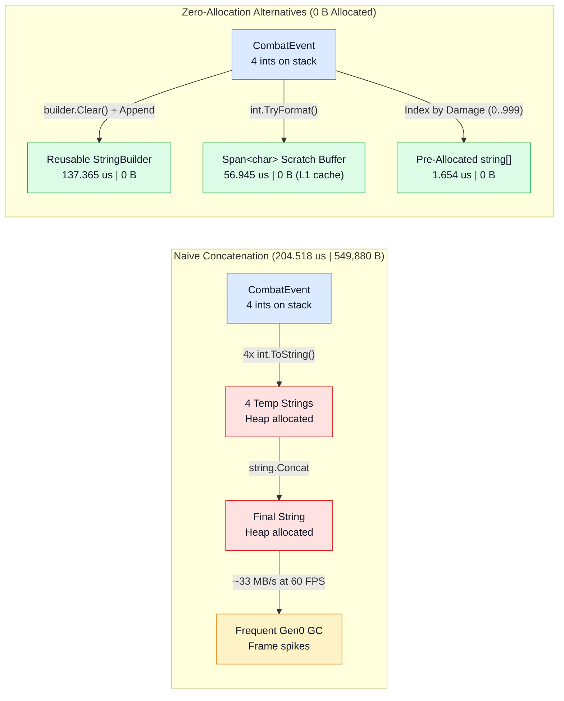

# String Allocations in Combat Text and HUD Formatting

## Table of Contents

- [Intuition: The Chalkboard vs. Printing a New Poster Every Frame](#intuition-the-chalkboard-vs-printing-a-new-poster-every-frame)
- [Why String Concatenation Allocates So Much](#why-string-concatenation-allocates-so-much)
- [Step-by-Step: Naive vs. Optimized Walkthroughs](#step-by-step-naive-vs-optimized-walkthroughs)
  - [1. Naive String Concatenation (`FormatBatchNaive`)](#1-naive-string-concatenation-formatbatchnaive)
  - [2. Reusable `StringBuilder` (`FormatBatchStringBuilder`)](#2-reusable-stringbuilder-formatbatchstringbuilder)
  - [3. Zero-Allocation `Span<char>` + `TryFormat` (`FormatBatchSpan`)](#3-zero-allocation-spanchar--tryformat-formatbatchspan)
  - [4. Pre-Allocated Lookup Table (`SumDamageLabelsCached`)](#4-pre-allocated-lookup-table-sumdamagelabelscached)
- [Trade-offs and Pitfalls (When NOT to Use)](#trade-offs-and-pitfalls-when-not-to-use)
- [Profiling and Diagnostics](#profiling-and-diagnostics)
- [Summary and Benchmark Results](#summary-and-benchmark-results)

---

## Intuition: The Chalkboard vs. Printing a New Poster Every Frame

Imagine you work at a busy arcade where 2,000 players are scoring points every 16 milliseconds. If you print a brand-new glossy paper poster for every single score update (`"#42 -185 (815/1000)"`) and throw the old poster on the floor, within one second the room is buried under 120,000 sheets of paper—and everyone has to stop playing while the janitor sweeps the floor.

In .NET, `string` is **immutable**: once created, its characters can never be edited in place. Building HUD labels with `+` or `$"..."` every frame is like printing and discarding glossy posters. The alternative is a **reusable chalkboard**: you either wipe and rewrite the same `StringBuilder`, write directly into a fixed `Span<char>` scratchpad on the CPU cache, or hang a pre-printed sign (`CachedDamageStrings`) for common numbers like `"-185"`.

---

## Why String Concatenation Allocates So Much

Each .NET `string` lives on the managed heap with an object header + MethodTable pointer (16 bytes on 64-bit), a length field, and UTF-16 characters (`2 bytes` per `char`). When you write:

```csharp
"#" + ev.TargetId.ToString(CultureInfo.InvariantCulture)
    + " -" + ev.Damage.ToString(CultureInfo.InvariantCulture)
    + " (" + ev.RemainingHp.ToString(CultureInfo.InvariantCulture)
    + "/" + ev.MaxHp.ToString(CultureInfo.InvariantCulture) + ")"
```

1. **Four temporary `int.ToString()` strings** are allocated on the heap just to turn numbers into text.
2. **A final concatenated `string`** is allocated via `string.Concat` to combine all pieces.
3. **At 2,000 events per frame**, that produces **`549,880 B` (~537 KB)** per frame—roughly **33 MB/s at 60 FPS**—forcing frequent **Gen0** (Generation 0, the short-lived nursery heap) garbage collections that compete with your frame budget.



---

## Step-by-Step: Naive vs. Optimized Walkthroughs

All implementations format [CombatEvent.cs](../Data/CombatEvent.cs) (`readonly record struct CombatEvent(int TargetId, int Damage, int RemainingHp, int MaxHp)`) inside [CombatTextFormatter.cs](../Data/CombatTextFormatter.cs).

### 1. Naive String Concatenation (`FormatBatchNaive`)

`FormatEventNaive` converts each integer individually and concatenates 9 fragments per event:

```csharp
public static string FormatEventNaive(CombatEvent ev)
{
    return "#" + ev.TargetId.ToString(CultureInfo.InvariantCulture)
        + " -" + ev.Damage.ToString(CultureInfo.InvariantCulture)
        + " (" + ev.RemainingHp.ToString(CultureInfo.InvariantCulture)
        + "/" + ev.MaxHp.ToString(CultureInfo.InvariantCulture) + ")";
}
```

`FormatBatchNaive` calls this in a loop over `2,000` events, allocating `549,880 B` and triggering `32.7148` Gen0 collections per 1,000 operations.

### 2. Reusable `StringBuilder` (`FormatBatchStringBuilder`)

Instead of allocating a new string each time, `FormatBatchStringBuilder` reuses a single pre-sized `StringBuilder` (`new StringBuilder(64)`):

```csharp
builder.Clear();
builder.Append('#')
    .Append(ev.TargetId)
    .Append(" -")
    .Append(ev.Damage)
    .Append(" (")
    .Append(ev.RemainingHp)
    .Append('/')
    .Append(ev.MaxHp)
    .Append(')');
```

`builder.Clear()` resets its character count to `0` while keeping its internal `char[]` chunk intact. Heap allocations drop to **`0 B`** and speed improves to `137.365 us` (**`1.49x` faster**), though internal chunk traversal and bounds checks still add overhead.

### 3. Zero-Allocation `Span<char>` + `TryFormat` (`FormatBatchSpan`)

`Span<char>` is a lightweight view (pointer + length) over a contiguous `char[]` or `stackalloc char[64]` buffer—no heap object wrapper, no chunked segments. `TryFormatEventSpan` writes each integer directly into the remaining slice via `int.TryFormat`:

```csharp
destination[pos++] = '#';
if (!ev.TargetId.TryFormat(destination.Slice(pos), out int n, default, CultureInfo.InvariantCulture))
{
    charsWritten = 0;
    return false;
}
pos += n;
```

Because characters are written sequentially into one flat buffer sitting hot in the CPU's L1 cache, `FormatBatchSpan` finishes in `56.945 us` (**`3.59x` faster**, **`0 B` allocated**).

### 4. Pre-Allocated Lookup Table (`SumDamageLabelsCached`)

When a legacy UI widget insists on receiving an actual `string` reference and values fall within a small known range (`0..999`), `CombatTextFormatter` pre-builds `CachedDamageStrings` once at startup:

```csharp
public static string GetDamageStringCached(int damage)
{
    if ((uint)damage < (uint)CachedDamageStrings.Length)
    {
        return CachedDamageStrings[damage];
    }

    return string.Concat("-", damage.ToString(CultureInfo.InvariantCulture));
}
```

Casting `damage` to `uint` checks both `damage >= 0` and `damage < CachedDamageStrings.Length` in a single comparison. Reading from the table skips formatting completely, reaching `1.654 us` (**`123.65x` faster**, **`0 B` allocated**).

---

## Trade-offs and Pitfalls (When NOT to Use)

1. **Buffer too small for `TryFormat`**: If `destination` is shorter than the formatted output, `TryFormatEventSpan` returns `false`. Size scratch buffers generously (e.g., `64` chars for combat text) or handle fallback growth outside the hot path.
2. **`Span<char>` is a `ref struct`**: You cannot store a `Span<char>` in a class field, box it as `object`, or use it across `await` boundaries. Pass `ReadOnlySpan<char>` synchronously to your renderer.
3. **Retained `StringBuilder` capacity**: If one rare log line appends 100,000 characters, `Clear()` keeps that huge buffer alive. Keep separate builders for bounded HUD text vs. unbounded logging.
4. **Lookup table memory footprint**: Pre-allocating `string[]` only makes sense for small bounded domains (`0..999` is ~32 KB). Do not pre-allocate millions of combinations.
5. **When NOT to use**: For cold-path error messages, startup logs, or one-off UI dialogs, plain `$"..."` string interpolation is clearer and fast enough.

---

## Profiling and Diagnostics

Verify zero-allocation text formatting using BenchmarkDotNet and .NET runtime counters:

```bash
# Run StringAllocations benchmark with memory diagnoser
dotnet run --project CSharpLessons -c Release -- --filter "*StringAllocations*" --job short --memory

# Monitor live allocation rate and Gen0 collections
dotnet-counters monitor --process-id <PID> --counters System.Runtime[alloc-rate,gen-0-gc-count]
```

In unit tests, assert `0 B` allocated around `FormatBatchSpan` using `GC.GetAllocatedBytesForCurrentThread()` (after JIT warmup):

```csharp
long before = GC.GetAllocatedBytesForCurrentThread();
CombatTextFormatter.FormatBatchSpan(events, scratchBuffer);
long allocated = GC.GetAllocatedBytesForCurrentThread() - before; // 0 B
```

Use **PerfView** (`GC Heap Alloc Stacks`) to catch hidden `int.ToString()` or `string.Concat` allocations inside frame loops.

---

## Summary and Benchmark Results

Measured on .NET 9.0.22 (AMD Ryzen 7 5800X, `2,000` combat events formatted per frame) in [Benchmark.md](../Benchmark.md):

| Method | Mean | StdDev | Ratio | Gen0 | Allocated | Speedup |
|---|---:|---:|---:|---:|---:|---:|
| `FormatNaiveConcatenation` | `204.518 us` | `3.462 us` | `1.000` | `32.7148` | `549,880 B` | `1.00x` |
| `FormatReusableStringBuilder` | `137.365 us` | `0.757 us` | `0.672` | `-` | `0 B` | `1.49x` |
| `FormatSpanTryFormat` | `56.945 us` | `0.762 us` | `0.278` | `-` | `0 B` | `3.59x` |
| `LookupPreallocatedDamageStrings` | `1.654 us` | `0.020 us` | `0.008` | `-` | `0 B` | `123.65x` |

**Key takeaway**: Switching from per-frame string concatenation to `Span<char>` + `TryFormat` eliminates **`549,880 B`** of heap churn per frame and runs **`3.59x` faster** (`204.518 us` down to `56.945 us`). When a `string` reference is mandatory for bounded integers, pre-allocated lookup tables deliver **`123.65x`** speedup at `0 B` runtime cost.
