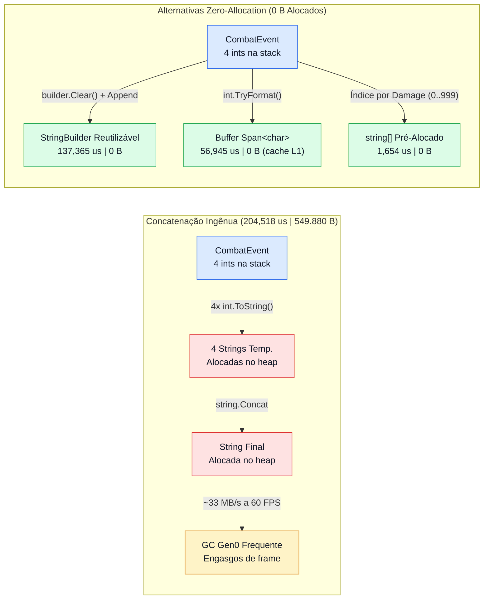

# Alocações de String em Textos de Combate e HUD

## Índice

- [Intuição: O Quadro Negro vs. Imprimir um Pôster Novo por Frame](#intuição-o-quadro-negro-vs-imprimir-um-pôster-novo-por-frame)
- [Por que Concatenar Strings Aloca Tanto](#por-que-concatenar-strings-aloca-tanto)
- [Passo a Passo: Abordagem Ingênua vs. Otimizadas](#passo-a-passo-abordagem-ingênua-vs-otimizadas)
  - [1. Concatenação Ingênua (`FormatBatchNaive`)](#1-concatenação-ingênua-formatbatchnaive)
  - [2. `StringBuilder` Reutilizável (`FormatBatchStringBuilder`)](#2-stringbuilder-reutilizável-formatbatchstringbuilder)
  - [3. `Span<char>` + `TryFormat` Zero-Allocation (`FormatBatchSpan`)](#3-spanchar--tryformat-zero-allocation-formatbatchspan)
  - [4. Tabela de Busca Pré-Alocada (`SumDamageLabelsCached`)](#4-tabela-de-busca-pré-alocada-sumdamagelabelscached)
- [Trade-offs e Armadilhas (Quando NÃO Usar)](#trade-offs-e-armadilhas-quando-não-usar)
- [Profiling e Diagnóstico](#profiling-e-diagnóstico)
- [Resumo e Resultados do Benchmark](#resumo-e-resultados-do-benchmark)

---

## Intuição: O Quadro Negro vs. Imprimir um Pôster Novo por Frame

Imagine um fliperama movimentado onde 2.000 jogadores pontuam a cada 16 milissegundos. Se você imprimir um pôster de papel brilhante novo para cada atualização de placar (`"#42 -185 (815/1000)"`) e jogar o anterior no chão, em um segundo a sala estará soterrada por 120.000 folhas — e todo mundo terá que parar de jogar enquanto o faxineiro varre a sala.

No .NET, `string` é **imutável**: depois de criada, seus caracteres nunca podem ser editados no lugar. Montar textos de HUD com `+` ou `$"..."` a cada frame é exatamente como imprimir e descartar pôsteres. A alternativa é um **quadro negro reutilizável**: apagar e reescrever o mesmo `StringBuilder`, escrever direto em um rascunho `Span<char>` na cache da CPU, ou pendurar placas pré-impressas (`CachedDamageStrings`) para números comuns como `"-185"`.

---

## Por que Concatenar Strings Aloca Tanto

Cada `string` no .NET vive no heap gerenciado com cabeçalho de objeto + ponteiro de MethodTable (16 bytes em 64 bits), campo de tamanho e caracteres UTF-16 (`2 bytes` por `char`). Quando você escreve:

```csharp
"#" + ev.TargetId.ToString(CultureInfo.InvariantCulture)
    + " -" + ev.Damage.ToString(CultureInfo.InvariantCulture)
    + " (" + ev.RemainingHp.ToString(CultureInfo.InvariantCulture)
    + "/" + ev.MaxHp.ToString(CultureInfo.InvariantCulture) + ")"
```

1. **Quatro strings temporárias `int.ToString()`** são alocadas no heap apenas para converter números em texto.
2. **Uma `string` final concatenada** é alocada via `string.Concat` para juntar todos os pedaços.
3. **Com 2.000 eventos por frame**, isso gera **`549.880 B` (~537 KB)** por frame — cerca de **33 MB/s a 60 FPS** — disparando coletas frequentes na **Gen0** (Geração 0, a área de objetos recém-criados do Garbage Collector) que disputam o orçamento do frame.



---

## Passo a Passo: Abordagem Ingênua vs. Otimizadas

Todas as implementações formatam [CombatEvent.cs](../Data/CombatEvent.cs) (`readonly record struct CombatEvent(int TargetId, int Damage, int RemainingHp, int MaxHp)`) dentro de [CombatTextFormatter.cs](../Data/CombatTextFormatter.cs).

### 1. Concatenação Ingênua (`FormatBatchNaive`)

`FormatEventNaive` converte cada inteiro separadamente e concatena 9 fragmentos por evento:

```csharp
public static string FormatEventNaive(CombatEvent ev)
{
    return "#" + ev.TargetId.ToString(CultureInfo.InvariantCulture)
        + " -" + ev.Damage.ToString(CultureInfo.InvariantCulture)
        + " (" + ev.RemainingHp.ToString(CultureInfo.InvariantCulture)
        + "/" + ev.MaxHp.ToString(CultureInfo.InvariantCulture) + ")";
}
```

`FormatBatchNaive` executa isso em loop para `2.000` eventos, alocando `549.880 B` e disparando `32,7148` coletas Gen0 a cada 1.000 operações.

### 2. `StringBuilder` Reutilizável (`FormatBatchStringBuilder`)

Em vez de alocar uma nova string toda vez, `FormatBatchStringBuilder` reutiliza um único `StringBuilder` pré-dimensionado (`new StringBuilder(64)`):

```csharp
builder.Clear();
builder.Append('#')
    .Append(ev.TargetId)
    .Append(" -")
    .Append(ev.Damage)
    .Append(" (")
    .Append(ev.RemainingHp)
    .Append('/')
    .Append(ev.MaxHp)
    .Append(')');
```

`builder.Clear()` zera a contagem de caracteres mantendo o array `char[]` interno intacto. As alocações no heap caem para **`0 B`** e o tempo melhora para `137,365 us` (**`1,49x` mais rápido**), embora o gerenciamento interno de blocos e checagens de limites ainda adicionem custo.

### 3. `Span<char>` + `TryFormat` Zero-Allocation (`FormatBatchSpan`)

`Span<char>` é uma visão leve (ponteiro + tamanho) sobre um `char[]` contíguo ou `stackalloc char[64]` — sem objeto extra no heap nem blocos encadeados. `TryFormatEventSpan` grava cada inteiro diretamente na fatia restante via `int.TryFormat`:

```csharp
destination[pos++] = '#';
if (!ev.TargetId.TryFormat(destination.Slice(pos), out int n, default, CultureInfo.InvariantCulture))
{
    charsWritten = 0;
    return false;
}
pos += n;
```

Como os caracteres são escritos sequencialmente em um único buffer plano quente na cache L1 da CPU, `FormatBatchSpan` termina em `56,945 us` (**`3,59x` mais rápido**, **`0 B` alocados**).

### 4. Tabela de Busca Pré-Alocada (`SumDamageLabelsCached`)

Quando uma API legada de UI exige uma referência `string` real e os valores estão em uma faixa pequena conhecida (`0..999`), `CombatTextFormatter` pré-constrói `CachedDamageStrings` uma única vez na inicialização:

```csharp
public static string GetDamageStringCached(int damage)
{
    if ((uint)damage < (uint)CachedDamageStrings.Length)
    {
        return CachedDamageStrings[damage];
    }

    return string.Concat("-", damage.ToString(CultureInfo.InvariantCulture));
}
```

Converter `damage` para `uint` valida `damage >= 0` e `damage < CachedDamageStrings.Length` em uma única comparação. Ler direto da tabela pula toda a formatação, chegando a `1,654 us` (**`123,65x` mais rápido**, **`0 B` alocados**).

---

## Trade-offs e Armadilhas (Quando NÃO Usar)

1. **Buffer pequeno demais para `TryFormat`**: Se `destination` for menor que o texto formatado, `TryFormatEventSpan` retorna `false`. Dimensione buffers de rascunho com folga (ex.: `64` caracteres para texto de combate) ou trate crescimento fora do hot path.
2. **`Span<char>` é uma `ref struct`**: Não pode ser guardado em campos de classe, sofrer boxing para `object` nem atravessar `await`. Passe `ReadOnlySpan<char>` de forma síncrona para o renderizador.
3. **Capacidade retida no `StringBuilder`**: Se um log raro inserir 100.000 caracteres, `Clear()` mantém esse buffer gigante alocado. Mantenha builders separados para HUD limitado e logs longos.
4. **Custo de memória da tabela de busca**: Pré-alocar `string[]` só compensa para faixas pequenas e limitadas (`0..999` ocupa ~32 KB). Não pré-aloque milhões de combinações.
5. **Quando NÃO usar**: Em mensagens de erro raras, logs de inicialização ou diálogos pontuais de UI, interpolação `$"..."` é mais legível e rápida o suficiente.

---

## Profiling e Diagnóstico

Valide formatação zero-allocation com BenchmarkDotNet e contadores de runtime do .NET:

```bash
# Executar benchmark StringAllocations com diagnóstico de memória
dotnet run --project CSharpLessons -c Release -- --filter "*StringAllocations*" --job short --memory

# Monitorar taxa de alocação e coletas Gen0 em tempo real
dotnet-counters monitor --process-id <PID> --counters System.Runtime[alloc-rate,gen-0-gc-count]
```

Em testes unitários, valide `0 B` alocados ao redor de `FormatBatchSpan` com `GC.GetAllocatedBytesForCurrentThread()` (após aquecimento JIT):

```csharp
long before = GC.GetAllocatedBytesForCurrentThread();
CombatTextFormatter.FormatBatchSpan(events, scratchBuffer);
long allocated = GC.GetAllocatedBytesForCurrentThread() - before; // 0 B
```

Use **PerfView** (`GC Heap Alloc Stacks`) para localizar alocações ocultas de `int.ToString()` ou `string.Concat` dentro de loops de frame.

---

## Resumo e Resultados do Benchmark

Medido no .NET 9.0.22 (AMD Ryzen 7 5800X, `2.000` eventos de combate formatados por frame) em [Benchmark.md](../Benchmark.md):

| Método | Média | Desvio Padrão | Razão | Gen0 | Alocado | Ganho |
|---|---:|---:|---:|---:|---:|---:|
| `FormatNaiveConcatenation` | `204,518 us` | `3,462 us` | `1,000` | `32,7148` | `549.880 B` | `1,00x` |
| `FormatReusableStringBuilder` | `137,365 us` | `0,757 us` | `0,672` | `-` | `0 B` | `1,49x` |
| `FormatSpanTryFormat` | `56,945 us` | `0,762 us` | `0,278` | `-` | `0 B` | `3,59x` |
| `LookupPreallocatedDamageStrings` | `1,654 us` | `0,020 us` | `0,008` | `-` | `0 B` | `123,65x` |

**Conclusão prática**: Trocar concatenação por frame por `Span<char>` + `TryFormat` elimina **`549.880 B`** de lixo no heap por frame e executa **`3,59x` mais rápido** (`204,518 us` para `56,945 us`). Quando uma referência `string` é obrigatória para inteiros limitados, tabelas pré-alocadas entregam **`123,65x`** de ganho com `0 B` alocados em runtime.
