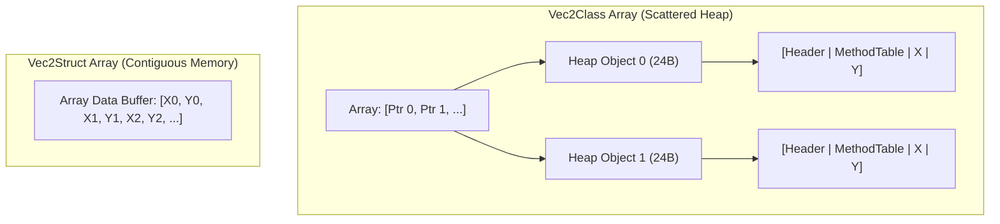

# Struct vs Class

## Table of Contents

- [Introduction](#introduction)
- [Reference Types vs Value Types](#reference-types-vs-value-types)
- [Memory Layout and Object Overhead](#memory-layout-and-object-overhead)
- [Array Layout and Cache Locality](#array-layout-and-cache-locality)
- [Garbage Collection and Frame Budgets](#garbage-collection-and-frame-budgets)
- [Best Practices for Structs](#best-practices-for-structs)
- [Summary](#summary)

---

## Introduction

In real-time systems and game loops running at 60 FPS (16.6 ms budget) or 120 FPS (8.3 ms budget), thousands of vector operations occur every frame. Deciding whether to represent mathematical primitives like 2D vectors as a `class` (reference type) or a `struct` (value type) fundamentally alters memory allocation and CPU cache utilization.

---

## Reference Types vs Value Types

- **Reference Type (`class Vec2Class`)**:
  - Allocated on the managed heap.
  - Variables hold a 64-bit reference (pointer) to the heap object.
  - Deallocation is managed by the Garbage Collector (GC).
- **Value Type (`readonly struct Vec2Struct`)**:
  - Allocated inline wherever declared (on the stack as local variables, or inside containing arrays/structs).
  - Variables contain the actual values (`X` and `Y` floats).
  - No heap allocation occurs during standard arithmetic or parameter passing.

---

## Memory Layout and Object Overhead

Every heap object in 64-bit .NET requires an object header (8 bytes) and a method table pointer (8 bytes). For a class containing two 32-bit `float` fields (8 bytes total):

- **`Vec2Class` instance**: 8 (header) + 8 (method table) + 8 (fields) = **24 bytes** on the heap, plus the 8-byte reference variable itself (32 bytes total).
- **`Vec2Struct` instance**: exactly **8 bytes** with zero metadata overhead.

---

## Array Layout and Cache Locality

When allocating an array of 100,000 vectors:

1. **`Vec2Class[]`**:
   - Allocates one array of 100,000 references (800 KB).
   - Allocates 100,000 individual heap objects (2.4 MB).
   - Iterating requires dereferencing pointers scattered across the heap, triggering frequent L1/L2/L3 cache misses.

2. **`Vec2Struct[]`**:
   - Allocates a single contiguous memory block of 800 KB.
   - Elements are stored sequentially in CPU cache lines (64 bytes hold 8 complete vectors).
   - The CPU prefetcher streams consecutive elements with near-zero memory latency.

---

## Garbage Collection and Frame Budgets

When vectors are immutable and perform addition (`a + b`), a class implementation returns `new Vec2Class(...)`. Integrating 100,000 entities per frame creates 100,000 short-lived objects per frame (~2.4 to 4.8 MB/frame). At 60 FPS, this translates to hundreds of megabytes per second, triggering Gen0 and Gen1 garbage collections that stall the main thread and drop frames.

Using `readonly struct Vec2Struct` eliminates heap allocations entirely (0 B allocated), guaranteeing zero GC pauses from physics and transform updates.

---

## Best Practices for Structs

1. **Mark structs as `readonly`**: Enforces immutability and prevents defensive copying by the compiler when passing with `in` or accessing `readonly` fields.
2. **Implement `IEquatable<T>`**: Prevents boxing when calling `Equals` or using collections like `HashSet<T>` and `Dictionary<TKey, TValue>`.
3. **Keep size small**: Microsoft guidelines recommend structs remain at or below 16 bytes for optimal pass-by-value efficiency.
4. **Pass with `in` for larger structs**: For structs larger than 16 bytes, use `in` parameters to pass by readonly reference without copying.

---

## Summary

| Metric | `class Vec2Class` | `readonly struct Vec2Struct` |
| --- | --- | --- |
| Storage | Managed Heap | Stack / Inline contiguous buffer |
| Memory Per Instance | 24 B heap + 8 B pointer | 8 B inline |
| Cache Locality | Poor (pointer chasing) | Excellent (linear prefetching) |
| Per-Operation Allocation | 24 B | 0 B |
| GC Pressure | High (Gen0/Gen1 churn) | None |
