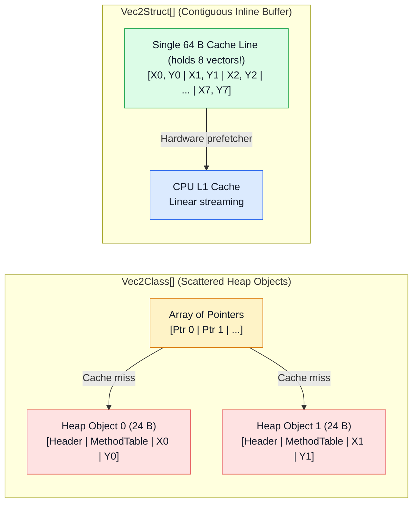

# Struct vs Class

## Table of Contents

- [Introduction](#introduction)
- [Reference Types vs Value Types](#reference-types-vs-value-types)
- [Memory Layout and Object Overhead](#memory-layout-and-object-overhead)
- [Array Layout and Cache Locality](#array-layout-and-cache-locality)
- [Garbage Collection and Frame Budgets](#garbage-collection-and-frame-budgets)
- [Best Practices and When NOT to Use Structs](#best-practices-and-when-not-to-use-structs)
- [Profiling and Diagnostics](#profiling-and-diagnostics)
- [Summary](#summary)

---

## Introduction

In real-time systems and game loops running at 60 FPS (16.6 ms budget) or 120 FPS (8.3 ms budget), thousands of vector operations occur every frame. Deciding whether to represent mathematical primitives like 2D vectors as a `class` (reference type) or a `struct` (value type) fundamentally alters memory allocation and CPU cache utilization.

---

## Reference Types vs Value Types

- **Reference Type (`class Vec2Class`)**:
  - Allocated on the managed heap.
  - Variables hold a 64-bit reference (pointer) to the heap object.
  - Deallocation is managed by the Garbage Collector (GC).
- **Value Type (`readonly struct Vec2Struct`)**:
  - Allocated inline wherever declared (on the stack as local variables, or inside containing arrays/structs).
  - Variables contain the actual values (`X` and `Y` floats).
  - No heap allocation occurs during standard arithmetic or parameter passing.

---

## Memory Layout and Object Overhead

Every heap object in 64-bit .NET carries two hidden metadata fields before your own data: an **object header** (8 bytes, used for locks and GC state) and a **MethodTable pointer** (8 bytes, telling the runtime which type the object is). For a class containing two 32-bit `float` fields (8 bytes total):

- **`Vec2Class` instance**: 8 (header) + 8 (MethodTable) + 8 (fields) = **24 bytes** on the heap, plus the 8-byte reference variable itself (32 bytes total).
- **`Vec2Struct` instance**: exactly **8 bytes** with zero metadata overhead.



---

## Array Layout and Cache Locality

When allocating an array of 100,000 vectors:

1. **`Vec2Class[]`**:
   - Allocates one array of 100,000 references (800 KB).
   - Allocates 100,000 individual heap objects (2.4 MB).
   - Iterating requires dereferencing pointers scattered across the heap, triggering frequent L1/L2/L3 cache misses.

2. **`Vec2Struct[]`**:
   - Allocates a single contiguous memory block of 800 KB.
   - Elements are stored sequentially in CPU cache lines (64 bytes hold 8 complete vectors).
   - The CPU prefetcher streams consecutive elements with near-zero memory latency.

---

## Garbage Collection and Frame Budgets

When vectors are immutable and perform addition (`a + b`), a class implementation returns `new Vec2Class(...)`. Integrating 100,000 entities per frame creates 100,000 short-lived objects per frame (~2.4 to 4.8 MB/frame). At 60 FPS, this translates to hundreds of megabytes per second, filling **Gen0** (Generation 0, where newly allocated objects live) and **Gen1** (survivors of Gen0) so fast that the Garbage Collector must pause the main thread and drop frames.

Using `readonly struct Vec2Struct` eliminates heap allocations entirely (0 B allocated), guaranteeing zero GC pauses from physics and transform updates.

---

## Best Practices and When NOT to Use Structs

1. **Mark structs as `readonly`**: Enforces immutability and prevents **defensive copying** (where the compiler silently copies the whole struct before calling a method on a `readonly` field or `in` parameter).
2. **Implement `IEquatable<T>`**: Prevents **boxing** (wrapping a value type inside a heap object) when calling `Equals` or using collections like `HashSet<T>` and `Dictionary<TKey, TValue>`.
3. **Keep size small**: Microsoft guidelines recommend structs remain at or below 16 bytes for optimal pass-by-value efficiency.
4. **Pass with `in` for larger structs**: For structs larger than 16 bytes, use `in` parameters to pass by readonly reference without copying.
5. **When NOT to use**: Use `class` when you need **reference identity** (multiple systems pointing to and mutating the same entity), polymorphism/inheritance, or when objects are large (> 64 bytes) and long-lived.

---

## Profiling and Diagnostics

Verify allocation differences and cache behavior using BenchmarkDotNet and .NET runtime counters:

```bash
# Run StructVsClass benchmark with memory diagnoser
dotnet run --project CSharpLessons -c Release -- --filter "*StructVsClass*" --job short --memory

# Monitor live allocation rate and Gen0/Gen1 collections
dotnet-counters monitor --process-id <PID> --counters System.Runtime[alloc-rate,gen-0-gc-count,gen-1-gc-count]
```

In unit tests, assert `0 B` allocated around struct math loops with `GC.GetAllocatedBytesForCurrentThread()`, or use **PerfView** (`GC Heap Alloc Stacks`) to spot accidental boxing or `new Class(...)` allocations in hot paths.

---

## Summary

| Metric | `class Vec2Class` | `readonly struct Vec2Struct` |
| --- | --- | --- |
| Storage | Managed Heap | Stack / Inline contiguous buffer |
| Memory Per Instance | 24 B heap + 8 B pointer | 8 B inline |
| Cache Locality | Poor (pointer chasing) | Excellent (linear prefetching) |
| Per-Operation Allocation | 24 B | 0 B |
| GC Pressure | High (Gen0/Gen1 churn) | None |
