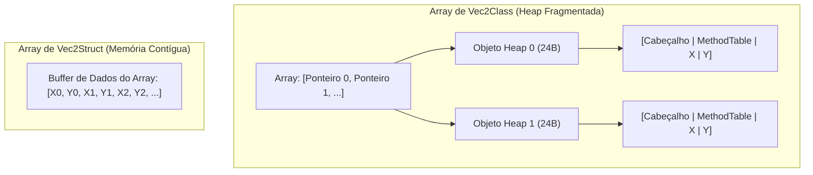

# Struct vs Class

## Sumário

- [Introdução](#introdução)
- [Tipos de Referência vs Tipos de Valor](#tipos-de-referência-vs-tipos-de-valor)
- [Layout de Memória e Sobrecarga de Objeto](#layout-de-memória-e-sobrecarga-de-objeto)
- [Layout em Arrays e Localidade de Cache](#layout-em-arrays-e-localidade-de-cache)
- [Coleta de Lixo e Orçamento de Frame](#coleta-de-lixo-e-orçamento-de-frame)
- [Boas Práticas com Structs](#boas-práticas-com-structs)
- [Resumo](#resumo)

---

## Introdução

Em sistemas de tempo real e loops de jogos executando a 60 FPS (orçamento de 16.6 ms) ou 120 FPS (8.3 ms), milhares de operações com vetores ocorrem a cada quadro. Decidir se primitivas matemáticas como vetores 2D devem ser modeladas como `class` (tipo de referência) ou `struct` (tipo de valor) altera profundamente a alocação de memória e o aproveitamento do cache da CPU.

---

## Tipos de Referência vs Tipos de Valor

- **Tipo de Referência (`class Vec2Class`)**:
  - Alocado na heap gerenciada.
  - Variáveis contêm uma referência de 64 bits (ponteiro) apontando para o objeto na heap.
  - Desalocação gerenciada pelo Garbage Collector (GC).
- **Tipo de Valor (`readonly struct Vec2Struct`)**:
  - Alocado em linha onde declarado (na stack como variáveis locais, ou sequencialmente dentro de arrays e structs).
  - Variáveis armazenam os valores reais (os floats `X` e `Y`).
  - Nenhuma alocação na heap ocorre durante cálculos aritméticos padrão.

---

## Layout de Memória e Sobrecarga de Objeto

No .NET de 64 bits, todo objeto na heap requer um cabeçalho de objeto (8 bytes) e um ponteiro para a Method Table (8 bytes). Para uma classe contendo dois campos `float` de 32 bits (8 bytes no total):

- **Instância de `Vec2Class`**: 8 (cabeçalho) + 8 (method table) + 8 (campos) = **24 bytes** na heap, somados aos 8 bytes do ponteiro da variável (32 bytes ao todo).
- **Instância de `Vec2Struct`**: exatamente **8 bytes**, sem nenhum metadado adicional.

---

## Layout em Arrays e Localidade de Cache

Ao alocar um array de 100.000 vetores:

1. **`Vec2Class[]`**:
   - Aloca um array de 100.000 referências (800 KB).
   - Aloca 100.000 instâncias independentes na heap (2.4 MB).
   - Iterar sobre o array exige desreferenciar ponteiros espalhados pela memória, gerando constantes falhas de cache L1/L2/L3.

2. **`Vec2Struct[]`**:
   - Aloca um único bloco contíguo de 800 KB na memória.
   - Elementos ficam dispostos lado a lado em linhas de cache da CPU (64 bytes comportam 8 vetores completos).
   - O prefetcher de hardware antecipa a leitura dos próximos dados sem latência perceptível.

---

## Coleta de Lixo e Orçamento de Frame

Quando vetores são imutáveis e implementam soma (`a + b`), a classe retorna `new Vec2Class(...)`. Integrar a física de 100.000 entidades por frame gera 100.000 objetos temporários a cada 16.6 ms (~2.4 a 4.8 MB/frame). Isso sobrecarrega a Gen0/Gen1 do GC, gerando pausas (GC spikes) que quebram a taxa de quadros.

Com `readonly struct Vec2Struct`, alocações na heap são reduzidas a **0 bytes**, eliminando coletas de lixo originadas do loop de atualização.

---

## Boas Práticas com Structs

1. **Declare como `readonly struct`**: Garante imutabilidade e impede que o compilador crie cópias defensivas ao usar parâmetros `in` ou acessar campos readonly.
2. **Implemente `IEquatable<T>`**: Evita boxing ao chamar `Equals` ou usar coleções genéricas como `HashSet<T>` e `Dictionary<TKey, TValue>`.
3. **Mantenha o tamanho compacto**: Recomenda-se manter structs com até 16 bytes para passagem eficiente por valor.
4. **Use `in` para structs maiores**: Para tipos com mais de 16 bytes, passe por referência somente leitura (`in`) para evitar custo de cópia de memória.

---

## Resumo

| Métrica | `class Vec2Class` | `readonly struct Vec2Struct` |
| --- | --- | --- |
| Armazenamento | Heap Gerenciada | Stack / Buffer contíguo |
| Memória por Instância | 24 B heap + 8 B ponteiro | 8 B em linha |
| Localidade de Cache | Baixa (pointer chasing) | Excelente (leitura sequencial) |
| Alocação por Operação | 24 B | 0 B |
| Pressão no GC | Alta (ciclos Gen0/Gen1) | Nula |
